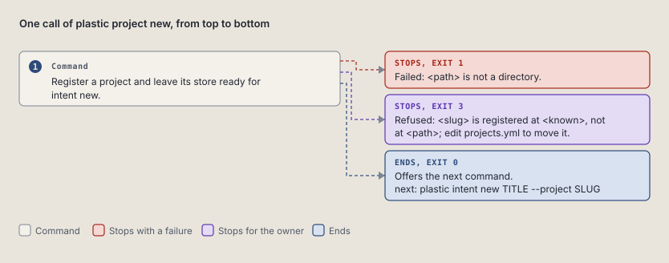

# plastic project new

Register a project and leave its store ready for intent new.

```sh
plastic project new SLUG PATH
```

| Argument or option | What it gives | Default |
| --- | --- | --- |
| `SLUG` | the project's name: lowercase letters, digits and dashes | |
| `PATH` | the project's repository folder | |

## The events of one call, step by step



The boxes on the left run in order. The boxes on the right are the ways the call stops or ends at that step.

## What one call changes

| What changes | Where | Reach |
| --- | --- | --- |
| The work database of the store is created if it is missing | the work graph database, in the store folder | stays on this machine |
| The knowledge database of the store is created if it is missing | the knowledge graph database, in the store folder | stays on this machine |
| The references database of the store is created if it is missing | the references database, in the store folder | stays on this machine |
| The project is registered in projects.yml in the Plastic home | the Plastic home folder | stays on this machine |

The command is `Plastic::Commands::Project::New`, in [`commands/project/new.rb`](../../../../lib/plastic/commands/project/new.rb).
