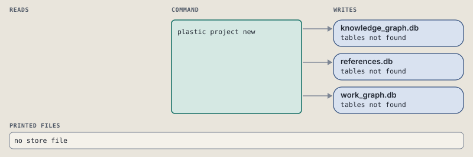

# plastic project new

Register a project and leave its store ready for intent new.

Registers a project in projects.yml and leaves its store ready, so an intent can be opened at once. The other lines of the file stay as they are. The same name at the same path again changes nothing.

```sh
plastic project new SLUG PATH
```

The command is `Project::New`, in [`new.rb:14`](../../../../lib/plastic/commands/project/new.rb#L14). The words on this page, such as gate, step and outcome, are explained in [the command DSL](../../dsl/README.md).

| Argument or option | What it gives | Default |
| --- | --- | --- |
| `SLUG` | the project's name: lowercase letters, digits and dashes | |
| `PATH` | the project's repository folder | |

## Components


The figure shows the command, the workflows it runs, the classes behind them, and the databases and files they reach.

## The events of one call


The command's `call`, at [`new.rb:19`](../../../../lib/plastic/commands/project/new.rb#L19):

```ruby
def call
  slug = checked_slug
  path = checked_path
  register(slug, path)
  make_ready(slug)
  announce(slug, path)
end
```

Its steps run in this order:

1. `slug = checked_slug` [`new.rb:20`](../../../../lib/plastic/commands/project/new.rb#L20)
2. `path = checked_path` [`new.rb:21`](../../../../lib/plastic/commands/project/new.rb#L21)
3. `register(slug, path)` [`new.rb:22`](../../../../lib/plastic/commands/project/new.rb#L22)
4. `make_ready(slug)` [`new.rb:23`](../../../../lib/plastic/commands/project/new.rb#L23)
5. `announce(slug, path)` [`new.rb:24`](../../../../lib/plastic/commands/project/new.rb#L24)

## What one call reads, writes and prints



| Place | Database or file | Tables | Reads or writes | Code |
| --- | --- | --- | --- | --- |
| the store folder | knowledge_graph.db | not found in the code | writes | [`new.rb:17`](../../../../lib/plastic/commands/project/new.rb#L17) |
| the store folder | references.db | not found in the code | writes | [`new.rb:17`](../../../../lib/plastic/commands/project/new.rb#L17) |
| the store folder | work_graph.db | not found in the code | writes | [`new.rb:17`](../../../../lib/plastic/commands/project/new.rb#L17) |

## How a call ends

Every call can also end in [the ways any call can end](../../dsl/README.md#how-any-call-can-end).

| Ending | Exit | next: | Code |
| --- | --- | --- | --- |
| Failed: PATH is not a directory | 1 | prints no next: line | [`new.rb:33`](../../../../lib/plastic/commands/project/new.rb#L33) |
| Refused: SLUG is registered at KNOWN, not at PATH; edit projects.yml to move it | 3 | prints no next: line | [`new.rb:41`](../../../../lib/plastic/commands/project/new.rb#L41) |
| Offers the next command | 0 | plastic intent new TITLE --project SLUG | [`new.rb:52`](../../../../lib/plastic/commands/project/new.rb#L52) |

## What the page leaves out

Every call shares a few things that this page does not repeat; [the command DSL](../../dsl/README.md#what-every-call-shares) names them.
