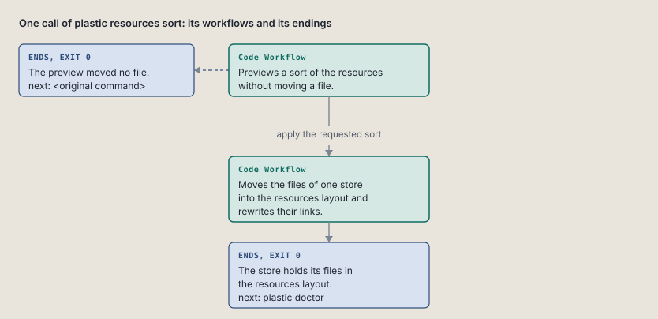
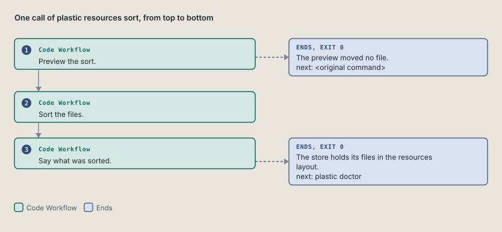

# plastic resources sort

Move one store's files into the resources layout and rewrite their links.

```sh
plastic resources sort --store SLUG --store SLUG [--dry-run]
```

| Argument or option | What it gives | Default |
| --- | --- | --- |
| `--store SLUG` | the registered project whose backups the call works on |  |
| `--store SLUG` | the registered project whose resources the call sorts |  |
| `--dry-run` | list the moves, the links that would change, the links left as they are and the amendments of closed intents, and move nothing | `false` |

## The workflows of one call



Each box is a workflow. The words between the boxes say when the call moves on, and the last boxes say how the call ends.

## The events of one call, step by step



The boxes on the left run in order. The boxes on the right are the ways the call stops or ends at that step.

## What one call changes

| What changes | Where | Reach |
| --- | --- | --- |
| Files move into the resources layout and the links that point at them are rewritten | the store folder | goes with the store |
| The rows of the moved files move with them, and the rows of the files with changed links are rewritten | the knowledge graph database, in the store folder | stays on this machine |
| The files move to resources/output, resources/references or resources/tmp, and the links that point at them are rewritten | the store folder | goes with the store |
| Each link rewritten in a root note of a done or abandoned intent gets an amended work log line, printed to its work.log | the work graph database, in the store folder | stays on this machine |

Goes with the store: the files of the store carry the change, and `plastic sync up` rebuilds it on another machine. The database files themselves stay on this machine.

The command is `Plastic::Commands::Resources::Sort`, in [`commands/resources/sort.rb`](../../../../lib/plastic/commands/resources/sort.rb).
