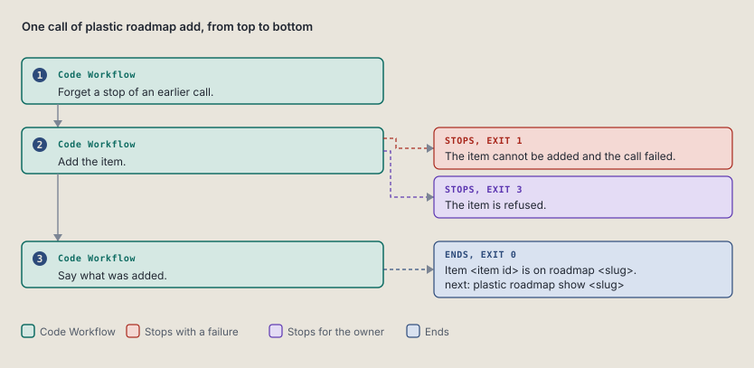

# plastic roadmap add

Add an item to a roadmap batch, with the items it needs.

```sh
plastic roadmap add SLUG N ITEM [--title TITLE] [--goal GOAL] [--done TEXT] [--needs ITEM]
```

| Argument or option | What it gives | Default |
| --- | --- | --- |
| `SLUG` | the roadmap | |
| `N` | the batch the item belongs to | |
| `ITEM` | the item's id | |
| `--title TITLE` | the item's title |  |
| `--goal GOAL` | the item's goal |  |
| `--done TEXT` | one done criterion; repeat for more | `[]` |
| `--needs ITEM` | an item this one needs; repeat for more | `[]` |

## The events of one call, step by step



The boxes on the left run in order. The boxes on the right are the ways the call stops or ends at that step.

## What one call changes

| What changes | Where | Reach |
| --- | --- | --- |
| The item is added to the roadmap | the work graph database, in the store folder | goes with the store |
| The files of the roadmap are rewritten | the store folder | goes with the store |

Goes with the store: the files of the store carry the change, and `plastic sync up` rebuilds it on another machine. The database files themselves stay on this machine.

The command is `Plastic::Commands::Roadmap::Add`, in [`add.rb:9`](../../../../lib/plastic/commands/roadmap/add.rb#L9).
