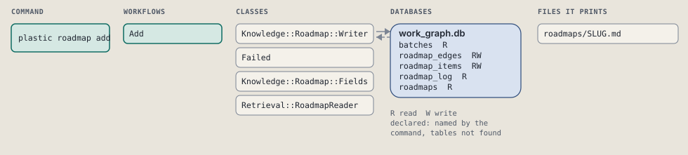
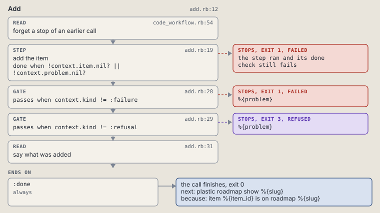
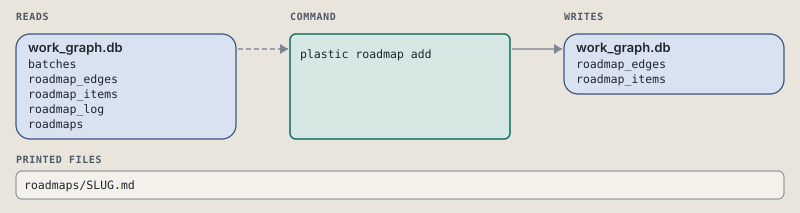

# plastic roadmap add

Add an item to a roadmap batch, with the items it needs.

```sh
plastic roadmap add SLUG N ITEM [--title TITLE] [--goal GOAL] [--done TEXT] [--needs ITEM]
```

The command is `Roadmap::Add`, in [`add.rb:9`](../../../../lib/plastic/commands/roadmap/add.rb#L9). The words on this page, such as gate, step and outcome, are explained in [the command DSL](../../dsl/README.md).

| Argument or option | What it gives | Default |
| --- | --- | --- |
| `SLUG` | the roadmap | |
| `N` | the batch the item belongs to | |
| `ITEM` | the item's id | |
| `--title TITLE` | the item's title |  |
| `--goal GOAL` | the item's goal |  |
| `--done TEXT` | one done criterion; repeat for more | `[]` |
| `--needs ITEM` | an item this one needs; repeat for more | `[]` |

## Components



The figure shows the command, the workflows it runs, the classes behind them, and the databases and files they reach.

## The events of one call

The call starts the workflow `Code::Roadmap::Add`, in [`add.rb:12`](../../../../lib/plastic/workflows/code/roadmap/add.rb#L12).

Adds one item to a roadmap batch, guarded against a missing batch, a predecessor not on the roadmap, and a loop over roadmap_edges.



Its rows run in this order:

1. Read: forget a stop of an earlier call. [`code_workflow.rb:54`](../../../../lib/plastic/code_workflow.rb#L54)
2. Step: add the item. Done when `!context.item.nil? || !context.problem.nil?`, so a second call skips it. [`add.rb:19`](../../../../lib/plastic/workflows/code/roadmap/add.rb#L19)
3. Gate: passes when `context.kind != :failure`; otherwise the call stops with exit 1 and prints PROBLEM. [`add.rb:28`](../../../../lib/plastic/workflows/code/roadmap/add.rb#L28)
4. Gate: passes when `context.kind != :refusal`; otherwise the call stops with exit 3 and prints PROBLEM. [`add.rb:29`](../../../../lib/plastic/workflows/code/roadmap/add.rb#L29)
5. Read: say what was added. [`add.rb:31`](../../../../lib/plastic/workflows/code/roadmap/add.rb#L31)
6. Outcome `:done`, always: finishes with exit 0; next: plastic roadmap show SLUG. [`add.rb:35`](../../../../lib/plastic/workflows/code/roadmap/add.rb#L35)

It sets `problem`, `kind`, `item`.

In the words of workflow engines, the rows are these four parts:

- **Trigger**: the call starts the workflow `Code::Roadmap::Add`.
- **Activities**: 2 reads and 1 step.
- **Transitions**: 2 gates stop the call when their checks fail; a step runs only while its done check fails.
- **Outcomes**: `:done` ends the call.

## What one call reads, writes and prints



| Place | Database or file | Tables | Reads or writes | Code |
| --- | --- | --- | --- | --- |
| the store folder | work_graph.db | `batches`, `roadmap_edges`, `roadmap_items`, `roadmap_log`, `roadmaps` | reads and writes | [`add.rb:18`](../../../../lib/plastic/commands/roadmap/add.rb#L18) |
| the store folder | roadmaps/SLUG.md | | writes | [`prints.rb:124`](../../../../lib/plastic/graph/prints.rb#L124) |

A second call runs the same rows again. A step runs again only when its done check fails.

| Step | Done when | The second call | Code |
| --- | --- | --- | --- |
| add the item | `!context.item.nil? \|\| !context.problem.nil?` | skips it | [`add.rb:19`](../../../../lib/plastic/workflows/code/roadmap/add.rb#L19) |

## How a call ends

Every call can also end in [the ways any call can end](../../dsl/README.md#how-any-call-can-end).

| Ending | Exit | next: | Code |
| --- | --- | --- | --- |
| PROBLEM | 1 | prints no next: line | [`add.rb:28`](../../../../lib/plastic/workflows/code/roadmap/add.rb#L28) |
| PROBLEM | 3 | prints no next: line | [`add.rb:29`](../../../../lib/plastic/workflows/code/roadmap/add.rb#L29) |
| item ITEM_ID is on roadmap SLUG | 0 | plastic roadmap show SLUG | [`add.rb:35`](../../../../lib/plastic/workflows/code/roadmap/add.rb#L35) |
| a step raises | 1 | prints no next: line | [`code_workflow.rb:102`](../../../../lib/plastic/code_workflow.rb#L102) |

## What the page leaves out

Every call shares a few things that this page does not repeat; [the command DSL](../../dsl/README.md#what-every-call-shares) names them.

- A call that writes saves a routine run row in local.db. A stop by a gate or a step saves the run, and the next call resumes from it. A dry run saves no row.
