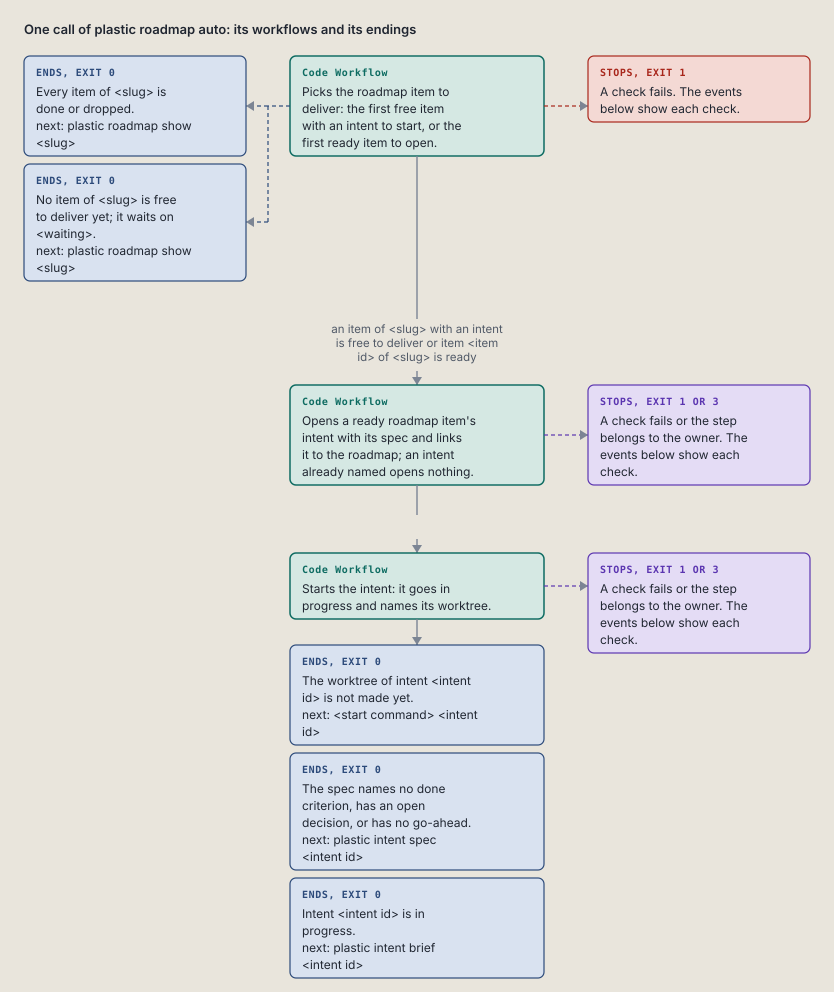
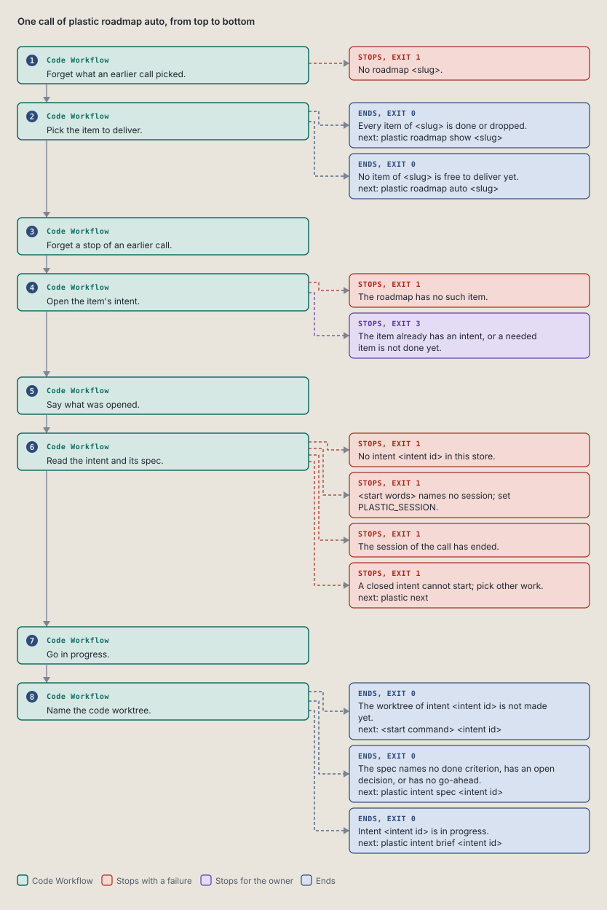

# plastic roadmap auto

Start a roadmap's next item for agent delivery: its first free item in flight, or its first ready item, opened first.

```sh
plastic roadmap auto SLUG
```

| Argument or option | What it gives | Default |
| --- | --- | --- |
| `SLUG` | the roadmap | |

## The workflows of one call



Each box is a workflow. The words between the boxes say when the call moves on, and the last boxes say how the call ends.

## The events of one call, step by step



The boxes on the left run in order. The boxes on the right are the ways the call stops or ends at that step.

## What one call changes

| What changes | Where | Reach |
| --- | --- | --- |
| The item's intent is opened and the item points to it | the work graph database, in the store folder | goes with the store |
| The intent goes in progress | the work graph database, in the store folder | goes with the store |
| The files of the intent and the index of the store are rewritten | the store folder | goes with the store |
| The files of the roadmap are rewritten | the store folder | goes with the store |

Goes with the store: the files of the store carry the change, and `plastic sync up` rebuilds it on another machine. The database files themselves stay on this machine.

The command is `Plastic::Commands::Roadmap::Auto`, in [`commands/roadmap/auto.rb`](../../../../lib/plastic/commands/roadmap/auto.rb).
