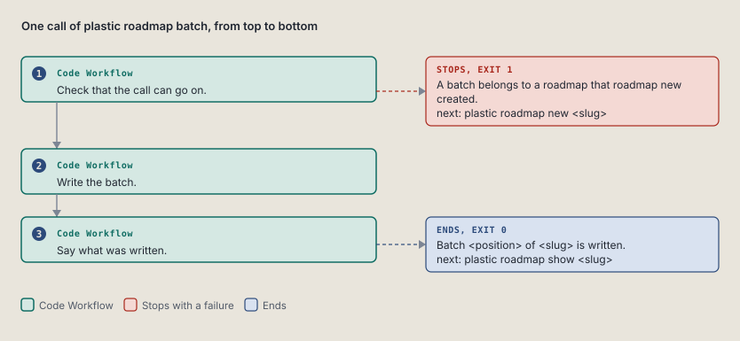

# plastic roadmap batch

Write one roadmap batch's goal and done criteria.

```sh
plastic roadmap batch SLUG N [--title TITLE] [--goal GOAL] [--done TEXT]
```

| Argument or option | What it gives | Default |
| --- | --- | --- |
| `SLUG` | the roadmap | |
| `N` | the batch's position, 1 and on | |
| `--title TITLE` | the batch's title |  |
| `--goal GOAL` | the batch's goal |  |
| `--done TEXT` | one done criterion; repeat for more | `[]` |

## The events of one call, step by step



The boxes on the left run in order. The boxes on the right are the ways the call stops or ends at that step.

## What one call changes

| What changes | Where | Reach |
| --- | --- | --- |
| The batch of the roadmap is written | the work graph database, in the store folder | goes with the store |
| The files of the roadmap are rewritten | the store folder | goes with the store |

Goes with the store: the files of the store carry the change, and `plastic sync up` rebuilds it on another machine. The database files themselves stay on this machine.

The command is `Plastic::Commands::Roadmap::Batch`, in [`batch.rb:9`](../../../../lib/plastic/commands/roadmap/batch.rb#L9).
