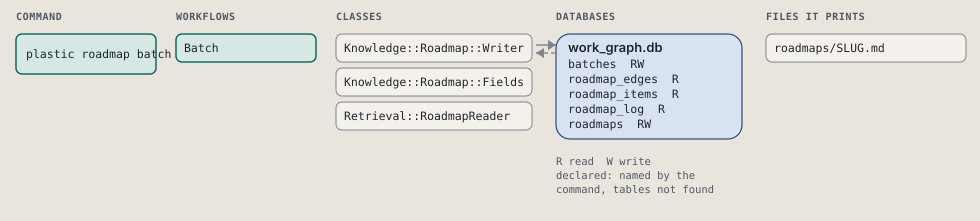
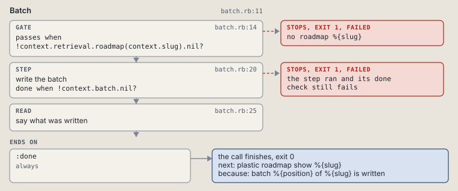
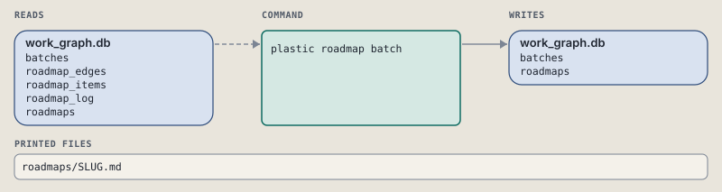

# plastic roadmap batch

Write one roadmap batch's goal and done criteria.

```sh
plastic roadmap batch SLUG N [--title TITLE] [--goal GOAL] [--done TEXT]
```

The command is `Roadmap::Batch`, in [`batch.rb:9`](../../../../lib/plastic/commands/roadmap/batch.rb#L9). The words on this page, such as gate, step and outcome, are explained in [the command DSL](../../dsl/README.md).

| Argument or option | What it gives | Default |
| --- | --- | --- |
| `SLUG` | the roadmap | |
| `N` | the batch's position, 1 and on | |
| `--title TITLE` | the batch's title |  |
| `--goal GOAL` | the batch's goal |  |
| `--done TEXT` | one done criterion; repeat for more | `[]` |

## Components



The figure shows the command, the workflows it runs, the classes behind them, and the databases and files they reach.

## The events of one call

The call starts the workflow `Code::Roadmap::Batch`, in [`batch.rb:11`](../../../../lib/plastic/workflows/code/roadmap/batch.rb#L11).

Writes a roadmap batch's goal and done criteria on a roadmap that exists.



Its rows run in this order:

1. Gate: passes when `!context.retrieval.roadmap(context.slug).nil?`; otherwise the call stops with exit 1 and prints no roadmap SLUG. [`batch.rb:14`](../../../../lib/plastic/workflows/code/roadmap/batch.rb#L14)
2. Step: write the batch. Done when `!context.batch.nil?`, so a second call skips it. [`batch.rb:20`](../../../../lib/plastic/workflows/code/roadmap/batch.rb#L20)
3. Read: say what was written. [`batch.rb:25`](../../../../lib/plastic/workflows/code/roadmap/batch.rb#L25)
4. Outcome `:done`, always: finishes with exit 0; next: plastic roadmap show SLUG. [`batch.rb:29`](../../../../lib/plastic/workflows/code/roadmap/batch.rb#L29)

It sets `batch`.

In the words of workflow engines, the rows are these four parts:

- **Trigger**: the call starts the workflow `Code::Roadmap::Batch`.
- **Activities**: 1 read and 1 step.
- **Transitions**: 1 gate stops the call when its check fails; a step runs only while its done check fails.
- **Outcomes**: `:done` end the call.

## What one call reads, writes and prints



| Place | Database or file | Tables | Reads or writes | Code |
| --- | --- | --- | --- | --- |
| the store folder | work_graph.db | `batches`, `roadmap_edges`, `roadmap_items`, `roadmap_log`, `roadmaps` | reads and writes | [`batch.rb:16`](../../../../lib/plastic/commands/roadmap/batch.rb#L16) |
| the store folder | roadmaps/SLUG.md | | writes | [`prints.rb:124`](../../../../lib/plastic/graph/prints.rb#L124) |

A second call runs the same rows again. A step runs again only when its done check fails.

| Step | Done when | The second call | Code |
| --- | --- | --- | --- |
| write the batch | `!context.batch.nil?` | skips it | [`batch.rb:20`](../../../../lib/plastic/workflows/code/roadmap/batch.rb#L20) |

## How a call ends

Every call can also end in [the ways any call can end](../../dsl/README.md#how-any-call-can-end).

| Ending | Exit | next: | Code |
| --- | --- | --- | --- |
| no roadmap SLUG | 1 | plastic roadmap new SLUG | [`batch.rb:14`](../../../../lib/plastic/workflows/code/roadmap/batch.rb#L14) |
| batch POSITION of SLUG is written | 0 | plastic roadmap show SLUG | [`batch.rb:29`](../../../../lib/plastic/workflows/code/roadmap/batch.rb#L29) |
| a step raises | 1 | prints no next: line | [`code_workflow.rb:102`](../../../../lib/plastic/code_workflow.rb#L102) |

## What the page leaves out

Every call shares a few things that this page does not repeat; [the command DSL](../../dsl/README.md#what-every-call-shares) names them.

- No gate of this command refuses, so exit 3 never happens.
- A call that writes saves a routine run row in local.db. A stop by a gate or a step saves the run, and the next call resumes from it. A dry run saves no row.
