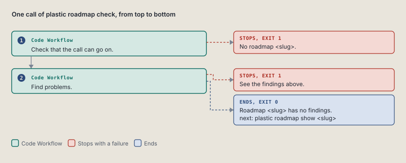

# plastic roadmap check

List a roadmap's loops, dangling edges and items with no intent.

```sh
plastic roadmap check SLUG
```

| Argument or option | What it gives | Default |
| --- | --- | --- |
| `SLUG` | the roadmap | |

## The events of one call, step by step



The boxes on the left run in order. The boxes on the right are the ways the call stops or ends at that step.

## What one call changes

This command changes nothing.

The command is `Plastic::Commands::Roadmap::Check`, in [`commands/roadmap/check.rb`](../../../../lib/plastic/commands/roadmap/check.rb).
