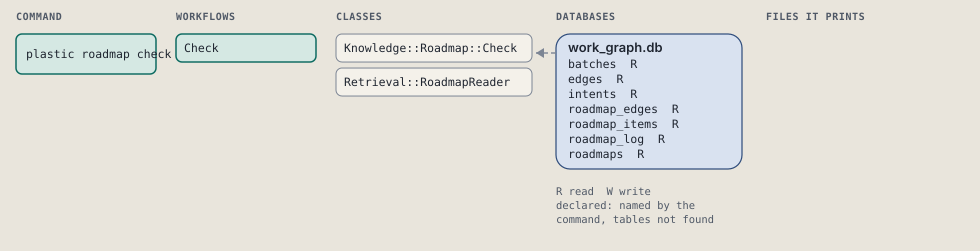
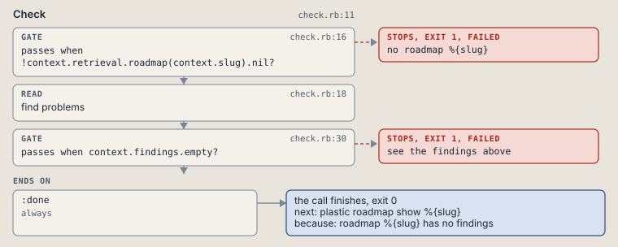
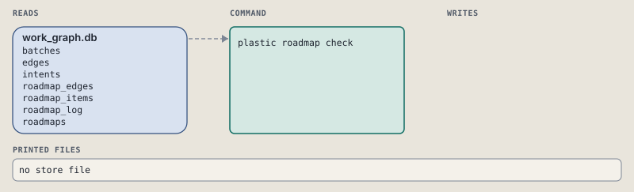

# plastic roadmap check

List a roadmap's loops, dangling edges and items with no intent.

```sh
plastic roadmap check SLUG
```

The command is `Roadmap::Check`, in [`check.rb:9`](../../../../lib/plastic/commands/roadmap/check.rb#L9). The words on this page, such as gate, step and outcome, are explained in [the command DSL](../../dsl/README.md).

| Argument or option | What it gives | Default |
| --- | --- | --- |
| `SLUG` | the roadmap | |

## Components



The figure shows the command, the workflows it runs, the classes behind them, and the databases and files they reach.

## The events of one call

The call starts the workflow `Code::Roadmap::Check`, in [`check.rb:11`](../../../../lib/plastic/workflows/code/roadmap/check.rb#L11).

Prints each finding, or "no findings"; a finding fails the call.



Its rows run in this order:

1. Gate: passes when `!context.retrieval.roadmap(context.slug).nil?`; otherwise the call stops with exit 1 and prints no roadmap SLUG. [`check.rb:16`](../../../../lib/plastic/workflows/code/roadmap/check.rb#L16)
2. Read: find problems. [`check.rb:18`](../../../../lib/plastic/workflows/code/roadmap/check.rb#L18)
3. Gate: passes when `context.findings.empty?`; otherwise the call stops with exit 1 and prints see the findings above. [`check.rb:30`](../../../../lib/plastic/workflows/code/roadmap/check.rb#L30)
4. Outcome `:done`, always: finishes with exit 0; next: plastic roadmap show SLUG. [`check.rb:32`](../../../../lib/plastic/workflows/code/roadmap/check.rb#L32)

It sets `findings`.

In the words of workflow engines, the rows are these four parts:

- **Trigger**: the call starts the workflow `Code::Roadmap::Check`.
- **Activities**: 1 read.
- **Transitions**: 2 gates stop the call when their checks fail.
- **Outcomes**: `:done` end the call.

## What one call reads, writes and prints



| Place | Database or file | Tables | Reads or writes | Code |
| --- | --- | --- | --- | --- |
| the store folder | work_graph.db | `batches`, `edges`, `intents`, `roadmap_edges`, `roadmap_items`, `roadmap_log`, `roadmaps` | reads | [`check.rb:12`](../../../../lib/plastic/commands/roadmap/check.rb#L12) |

## How a call ends

Every call can also end in [the ways any call can end](../../dsl/README.md#how-any-call-can-end).

| Ending | Exit | next: | Code |
| --- | --- | --- | --- |
| no roadmap SLUG | 1 | prints no next: line | [`check.rb:16`](../../../../lib/plastic/workflows/code/roadmap/check.rb#L16) |
| see the findings above | 1 | prints no next: line | [`check.rb:30`](../../../../lib/plastic/workflows/code/roadmap/check.rb#L30) |
| roadmap SLUG has no findings | 0 | plastic roadmap show SLUG | [`check.rb:32`](../../../../lib/plastic/workflows/code/roadmap/check.rb#L32) |
| a step raises | 1 | prints no next: line | [`code_workflow.rb:102`](../../../../lib/plastic/code_workflow.rb#L102) |

## What the page leaves out

Every call shares a few things that this page does not repeat; [the command DSL](../../dsl/README.md#what-every-call-shares) names them.

- No gate of this command refuses, so exit 3 never happens.
