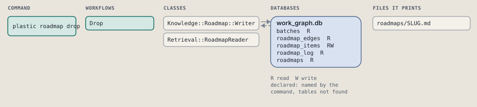
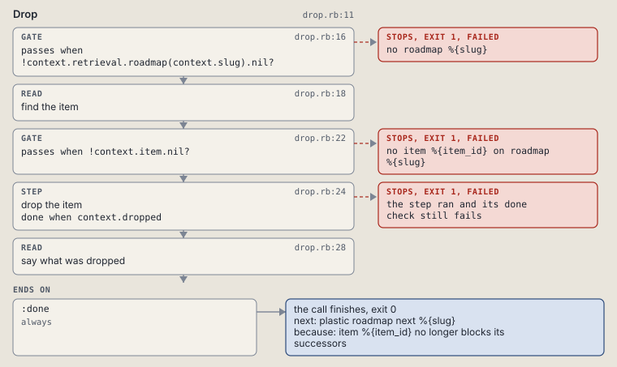
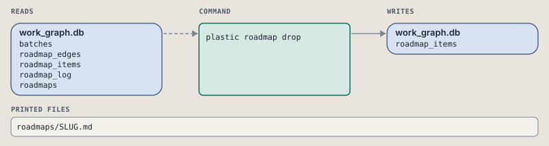

# plastic roadmap drop

Mark a roadmap item dropped; its edges stay as rows.

```sh
plastic roadmap drop SLUG ITEM [--dry-run]
```

The command is `Roadmap::Drop`, in [`drop.rb:9`](../../../../lib/plastic/commands/roadmap/drop.rb#L9). The words on this page, such as gate, step and outcome, are explained in [the command DSL](../../dsl/README.md).

| Argument or option | What it gives | Default |
| --- | --- | --- |
| `SLUG` | the roadmap | |
| `ITEM` | the item to drop | |
| `--dry-run` | preview the call in a disposable copy | `false` |

## Components



The figure shows the command, the workflows it runs, the classes behind them, and the databases and files they reach.

## The events of one call

The call starts the workflow `Code::Roadmap::Drop`, in [`drop.rb:11`](../../../../lib/plastic/workflows/code/roadmap/drop.rb#L11).

Marks a roadmap item dropped. Its edges stay; items after it stop waiting for it, since a dropped predecessor counts as resolved.



Its rows run in this order:

1. Gate: passes when `!context.retrieval.roadmap(context.slug).nil?`; otherwise the call stops with exit 1 and prints no roadmap SLUG. [`drop.rb:16`](../../../../lib/plastic/workflows/code/roadmap/drop.rb#L16)
2. Read: find the item. [`drop.rb:18`](../../../../lib/plastic/workflows/code/roadmap/drop.rb#L18)
3. Gate: passes when `!context.item.nil?`; otherwise the call stops with exit 1 and prints no item ITEM_ID on roadmap SLUG. [`drop.rb:22`](../../../../lib/plastic/workflows/code/roadmap/drop.rb#L22)
4. Step: drop the item. Done when `context.dropped`, so a second call skips it. [`drop.rb:24`](../../../../lib/plastic/workflows/code/roadmap/drop.rb#L24)
5. Read: say what was dropped. [`drop.rb:28`](../../../../lib/plastic/workflows/code/roadmap/drop.rb#L28)
6. Outcome `:done`, always: finishes with exit 0; next: plastic roadmap next SLUG. [`drop.rb:32`](../../../../lib/plastic/workflows/code/roadmap/drop.rb#L32)

It sets `item`, `dropped`.

In the words of workflow engines, the rows are these four parts:

- **Trigger**: the call starts the workflow `Code::Roadmap::Drop`.
- **Activities**: 2 reads and 1 step.
- **Transitions**: 2 gates stop the call when their checks fail; a step runs only while its done check fails.
- **Outcomes**: `:done` ends the call.

## What one call reads, writes and prints



| Place | Database or file | Tables | Reads or writes | Code |
| --- | --- | --- | --- | --- |
| the store folder | work_graph.db | `batches`, `roadmap_edges`, `roadmap_items`, `roadmap_log`, `roadmaps` | reads and writes | [`drop.rb:13`](../../../../lib/plastic/commands/roadmap/drop.rb#L13) |
| the store folder | roadmaps/SLUG.md | | writes | [`prints.rb:124`](../../../../lib/plastic/graph/prints.rb#L124) |

A second call runs the same rows again. A step runs again only when its done check fails.

| Step | Done when | The second call | Code |
| --- | --- | --- | --- |
| drop the item | `context.dropped` | skips it | [`drop.rb:24`](../../../../lib/plastic/workflows/code/roadmap/drop.rb#L24) |

## How a call ends

Every call can also end in [the ways any call can end](../../dsl/README.md#how-any-call-can-end).

| Ending | Exit | next: | Code |
| --- | --- | --- | --- |
| no roadmap SLUG | 1 | prints no next: line | [`drop.rb:16`](../../../../lib/plastic/workflows/code/roadmap/drop.rb#L16) |
| no item ITEM_ID on roadmap SLUG | 1 | prints no next: line | [`drop.rb:22`](../../../../lib/plastic/workflows/code/roadmap/drop.rb#L22) |
| item ITEM_ID no longer blocks its successors | 0 | plastic roadmap next SLUG | [`drop.rb:32`](../../../../lib/plastic/workflows/code/roadmap/drop.rb#L32) |
| a step raises | 1 | prints no next: line | [`code_workflow.rb:102`](../../../../lib/plastic/code_workflow.rb#L102) |

## What the page leaves out

Every call shares a few things that this page does not repeat; [the command DSL](../../dsl/README.md#what-every-call-shares) names them.

- A call that writes saves a routine run row in local.db. A stop by a gate or a step saves the run, and the next call resumes from it. A dry run saves no row.
