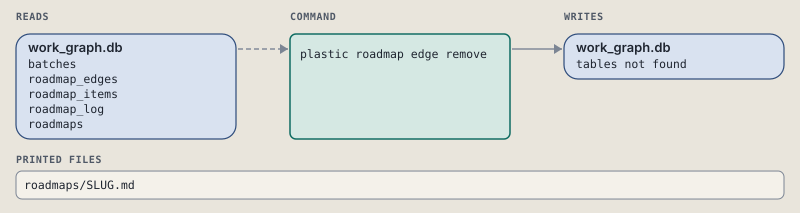

# plastic roadmap edge remove

Remove one needs edge from a roadmap.

Removes one needs edge. Fails when no such edge exists.

```sh
plastic roadmap edge remove SLUG FROM TO [--dry-run]
```

The command is `Roadmap::Edge::Remove`, in [`remove.rb:10`](../../../../lib/plastic/commands/roadmap/edge/remove.rb#L10). The words on this page, such as gate, step and outcome, are explained in [the command DSL](../../dsl/README.md).

| Argument or option | What it gives | Default |
| --- | --- | --- |
| `SLUG` | the roadmap | |
| `FROM` | the edge's start | |
| `TO` | the edge's end | |
| `--dry-run` | preview the call in a disposable copy | `false` |

## Components


The figure shows the command, the workflows it runs, the classes behind them, and the databases and files they reach.

## The events of one call

The call starts the workflow `Code::Roadmap::Edge::Remove`, in [`remove.rb:11`](../../../../lib/plastic/workflows/code/roadmap/edge/remove.rb#L11).

Removes one needs edge; fails when no such edge exists.


Its rows run in this order:

1. Read: forget a stop of an earlier call. [`code_workflow.rb:54`](../../../../lib/plastic/code_workflow.rb#L54)
2. Step: remove the edge. Done when `!context.removed.nil?`, so a second call skips it. [`remove.rb:18`](../../../../lib/plastic/workflows/code/roadmap/edge/remove.rb#L18)
3. Gate: passes when `context.problem.nil?`; otherwise the call stops with exit 1 and prints PROBLEM. [`remove.rb:24`](../../../../lib/plastic/workflows/code/roadmap/edge/remove.rb#L24)
4. Read: say what was removed. [`remove.rb:26`](../../../../lib/plastic/workflows/code/roadmap/edge/remove.rb#L26)
5. Outcome `:done`, always: finishes with exit 0; next: plastic roadmap show SLUG. [`remove.rb:30`](../../../../lib/plastic/workflows/code/roadmap/edge/remove.rb#L30)

It sets `problem`, `removed`.

In the words of workflow engines, the rows are these four parts:

- **Trigger**: the call starts the workflow `Code::Roadmap::Edge::Remove`.
- **Activities**: 2 reads and 1 step.
- **Transitions**: 1 gate stops the call when its check fails; a step runs only while its done check fails.
- **Outcomes**: `:done` ends the call.

## What one call reads, writes and prints



| Place | Database or file | Tables | Reads or writes | Code |
| --- | --- | --- | --- | --- |
| the store folder | work_graph.db | `batches`, `roadmap_edges`, `roadmap_items`, `roadmap_log`, `roadmaps` | reads and writes | [`remove.rb:15`](../../../../lib/plastic/commands/roadmap/edge/remove.rb#L15) |
| the store folder | roadmaps/SLUG.md | | writes | [`prints.rb:124`](../../../../lib/plastic/graph/prints.rb#L124) |

A second call runs the same rows again. A step runs again only when its done check fails.

| Step | Done when | The second call | Code |
| --- | --- | --- | --- |
| remove the edge | `!context.removed.nil?` | skips it | [`remove.rb:18`](../../../../lib/plastic/workflows/code/roadmap/edge/remove.rb#L18) |

## How a call ends

Every call can also end in [the ways any call can end](../../dsl/README.md#how-any-call-can-end).

| Ending | Exit | next: | Code |
| --- | --- | --- | --- |
| PROBLEM | 1 | prints no next: line | [`remove.rb:24`](../../../../lib/plastic/workflows/code/roadmap/edge/remove.rb#L24) |
| edge FROM to TO is gone | 0 | plastic roadmap show SLUG | [`remove.rb:30`](../../../../lib/plastic/workflows/code/roadmap/edge/remove.rb#L30) |
| a step raises | 1 | prints no next: line | [`code_workflow.rb:102`](../../../../lib/plastic/code_workflow.rb#L102) |

## What the page leaves out

Every call shares a few things that this page does not repeat; [the command DSL](../../dsl/README.md#what-every-call-shares) names them.

- A call that writes saves a routine run row in local.db. A stop by a gate or a step saves the run, and the next call resumes from it. A dry run saves no row.
