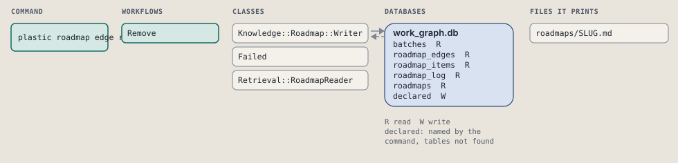
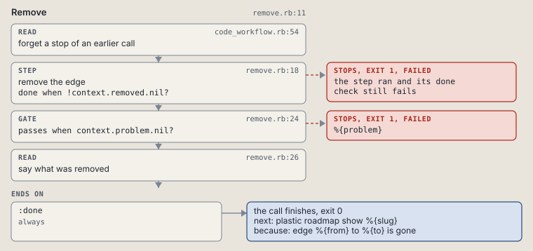

# plastic roadmap edge remove

Remove one needs edge from a roadmap.

Removes one needs edge. Fails when no such edge exists.

```sh
plastic roadmap edge remove SLUG FROM TO [--dry-run]
```

The command is `Roadmap::Edge::Remove`, in [`remove.rb:10`](../../../../lib/plastic/commands/roadmap/edge/remove.rb#L10). The words on this page, such as gate, step and outcome, are explained in [the command DSL](../../dsl/README.md).

| Argument or option | What it gives | Default |
| --- | --- | --- |
| `SLUG` | the roadmap | |
| `FROM` | the edge's start | |
| `TO` | the edge's end | |
| `--dry-run` | preview the call in a disposable copy | `false` |

## What it touches



## How the call flows


| Workflow | Kind | Code |
| --- | --- | --- |
| [Code::Roadmap::Edge::Remove](#coderoadmapedgeremove) | code | [`remove.rb:11`](../../../../lib/plastic/workflows/code/roadmap/edge/remove.rb#L11) |

### Code::Roadmap::Edge::Remove

The code workflow `:code_remove_roadmap_edge`, in [`remove.rb:11`](../../../../lib/plastic/workflows/code/roadmap/edge/remove.rb#L11).

Removes one needs edge; fails when no such edge exists.



| Step | Kind | Check | Code |
| --- | --- | --- | --- |
| forget a stop of an earlier call | read |  | [`code_workflow.rb:54`](../../../../lib/plastic/code_workflow.rb#L54) |
| remove the edge | step | `!context.removed.nil?` | [`remove.rb:18`](../../../../lib/plastic/workflows/code/roadmap/edge/remove.rb#L18) |
| %{problem} | gate, stops with exit 1 | `context.problem.nil?` | [`remove.rb:24`](../../../../lib/plastic/workflows/code/roadmap/edge/remove.rb#L24) |
| say what was removed | read |  | [`remove.rb:26`](../../../../lib/plastic/workflows/code/roadmap/edge/remove.rb#L26) |

| Outcome | When | Then | Code |
| --- | --- | --- | --- |
| `:done` | always | finishes, exit 0; next: plastic roadmap show %{slug} | [`remove.rb:30`](../../../../lib/plastic/workflows/code/roadmap/edge/remove.rb#L30) |

It sets `problem`, `removed`.

## Outcomes

Every call can also end in [the ways any call can end](../../dsl/README.md#how-any-call-can-end).

| Ending | Exit | next: | Code |
| --- | --- | --- | --- |
| %{problem} | 1 | prints no next: line | [`remove.rb:24`](../../../../lib/plastic/workflows/code/roadmap/edge/remove.rb#L24) |
| edge %{from} to %{to} is gone | 0 | plastic roadmap show %{slug} | [`remove.rb:30`](../../../../lib/plastic/workflows/code/roadmap/edge/remove.rb#L30) |
| a step raises | 1 | prints no next: line | [`code_workflow.rb:102`](../../../../lib/plastic/code_workflow.rb#L102) |
