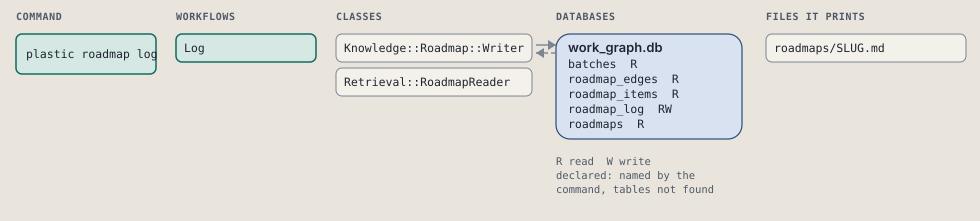
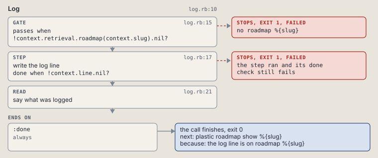
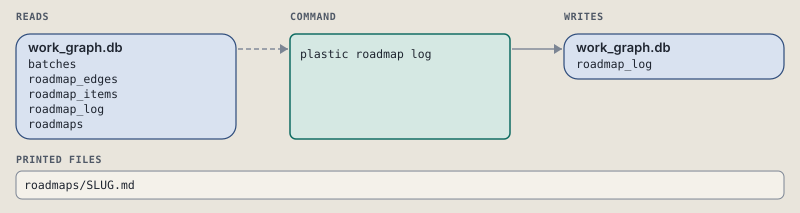

# plastic roadmap log

Append a log line to a roadmap, stamped with the session id.

```sh
plastic roadmap log SLUG TEXT...
```

The command is `Roadmap::Log`, in [`log.rb:9`](../../../../lib/plastic/commands/roadmap/log.rb#L9). The words on this page, such as gate, step and outcome, are explained in [the command DSL](../../dsl/README.md).

| Argument or option | What it gives | Default |
| --- | --- | --- |
| `SLUG` | the roadmap | |
| `TEXT` | the log line | |

## Components



The figure shows the command, the workflows it runs, the classes behind them, and the databases and files they reach.

## The events of one call

The call starts the workflow `Code::Roadmap::Log`, in [`log.rb:10`](../../../../lib/plastic/workflows/code/roadmap/log.rb#L10).

Appends one log line to a roadmap, stamped with the session id.



Its rows run in this order:

1. Gate: passes when `!context.retrieval.roadmap(context.slug).nil?`; otherwise the call stops with exit 1 and prints no roadmap SLUG. [`log.rb:15`](../../../../lib/plastic/workflows/code/roadmap/log.rb#L15)
2. Step: write the log line. Done when `!context.line.nil?`, so a second call skips it. [`log.rb:17`](../../../../lib/plastic/workflows/code/roadmap/log.rb#L17)
3. Read: say what was logged. [`log.rb:21`](../../../../lib/plastic/workflows/code/roadmap/log.rb#L21)
4. Outcome `:done`, always: finishes with exit 0; next: plastic roadmap show SLUG. [`log.rb:25`](../../../../lib/plastic/workflows/code/roadmap/log.rb#L25)

It sets `line`.

In the words of workflow engines, the rows are these four parts:

- **Trigger**: the call starts the workflow `Code::Roadmap::Log`.
- **Activities**: 1 read and 1 step.
- **Transitions**: 1 gate stops the call when its check fails; a step runs only while its done check fails.
- **Outcomes**: `:done` end the call.

## What one call reads, writes and prints



| Place | Database or file | Tables | Reads or writes | Code |
| --- | --- | --- | --- | --- |
| the store folder | work_graph.db | `batches`, `roadmap_edges`, `roadmap_items`, `roadmap_log`, `roadmaps` | reads and writes | [`log.rb:13`](../../../../lib/plastic/commands/roadmap/log.rb#L13) |
| the store folder | roadmaps/SLUG.md | | writes | [`prints.rb:124`](../../../../lib/plastic/graph/prints.rb#L124) |

A second call runs the same rows again. A step runs again only when its done check fails.

| Step | Done when | The second call | Code |
| --- | --- | --- | --- |
| write the log line | `!context.line.nil?` | skips it | [`log.rb:17`](../../../../lib/plastic/workflows/code/roadmap/log.rb#L17) |

## How a call ends

Every call can also end in [the ways any call can end](../../dsl/README.md#how-any-call-can-end).

| Ending | Exit | next: | Code |
| --- | --- | --- | --- |
| no roadmap SLUG | 1 | prints no next: line | [`log.rb:15`](../../../../lib/plastic/workflows/code/roadmap/log.rb#L15) |
| the log line is on roadmap SLUG | 0 | plastic roadmap show SLUG | [`log.rb:25`](../../../../lib/plastic/workflows/code/roadmap/log.rb#L25) |
| a step raises | 1 | prints no next: line | [`code_workflow.rb:102`](../../../../lib/plastic/code_workflow.rb#L102) |

## What the page leaves out

Every call shares a few things that this page does not repeat; [the command DSL](../../dsl/README.md#what-every-call-shares) names them.

- No gate of this command refuses, so exit 3 never happens.
- A call that writes saves a routine run row in local.db. A stop by a gate or a step saves the run, and the next call resumes from it. A dry run saves no row.
