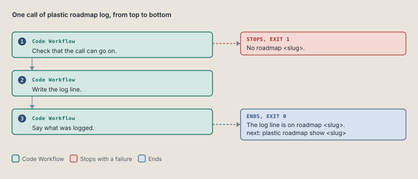

# plastic roadmap log

Append a log line to a roadmap, stamped with the session id.

```sh
plastic roadmap log SLUG TEXT...
```

| Argument or option | What it gives | Default |
| --- | --- | --- |
| `SLUG` | the roadmap | |
| `TEXT` | the log line | |

## The events of one call, step by step



The boxes on the left run in order. The boxes on the right are the ways the call stops or ends at that step.

## What one call changes

| What changes | Where | Reach |
| --- | --- | --- |
| A line is added to the log of the roadmap | the work graph database, in the store folder | goes with the store |
| The files of the roadmap are rewritten | the store folder | goes with the store |

Goes with the store: the files of the store carry the change, and `plastic sync up` rebuilds it on another machine. The database files themselves stay on this machine.

The command is `Plastic::Commands::Roadmap::Log`, in [`log.rb:9`](../../../../lib/plastic/commands/roadmap/log.rb#L9).
