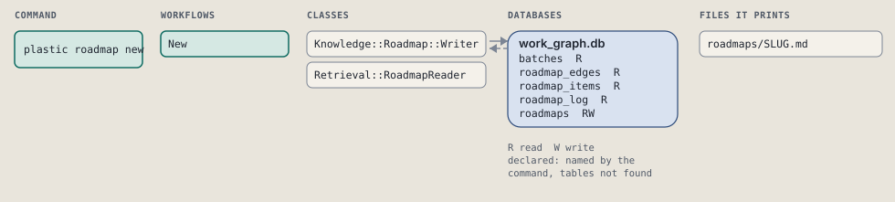
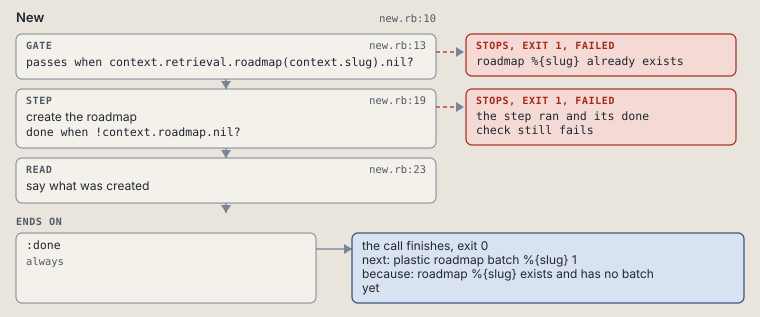
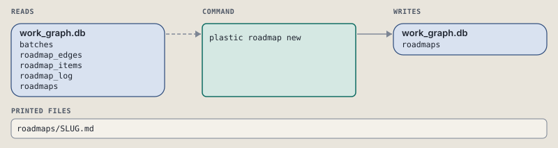

# plastic roadmap new

Create a roadmap; write its batches with roadmap batch.

```sh
plastic roadmap new NAME [--title TITLE] [--goal GOAL]
```

The command is `Roadmap::New`, in [`new.rb:9`](../../../../lib/plastic/commands/roadmap/new.rb#L9). The words on this page, such as gate, step and outcome, are explained in [the command DSL](../../dsl/README.md).

| Argument or option | What it gives | Default |
| --- | --- | --- |
| `NAME` | the roadmap's name | |
| `--title TITLE` | the roadmap's title; the name when absent |  |
| `--goal GOAL` | the roadmap's goal |  |

## Components



The figure shows the command, the workflows it runs, the classes behind them, and the databases and files they reach.

## The events of one call

The call starts the workflow `Code::Roadmap::New`, in [`new.rb:10`](../../../../lib/plastic/workflows/code/roadmap/new.rb#L10).

Creates a roadmap row and offers its first batch.



Its rows run in this order:

1. Gate: passes when `context.retrieval.roadmap(context.slug).nil?`; otherwise the call stops with exit 1 and prints roadmap SLUG already exists. [`new.rb:13`](../../../../lib/plastic/workflows/code/roadmap/new.rb#L13)
2. Step: create the roadmap. Done when `!context.roadmap.nil?`, so a second call skips it. [`new.rb:19`](../../../../lib/plastic/workflows/code/roadmap/new.rb#L19)
3. Read: say what was created. [`new.rb:23`](../../../../lib/plastic/workflows/code/roadmap/new.rb#L23)
4. Outcome `:done`, always: finishes with exit 0; next: plastic roadmap batch SLUG 1. [`new.rb:27`](../../../../lib/plastic/workflows/code/roadmap/new.rb#L27)

It sets `roadmap`.

In the words of workflow engines, the rows are these four parts:

- **Trigger**: the call starts the workflow `Code::Roadmap::New`.
- **Activities**: 1 read and 1 step.
- **Transitions**: 1 gate stops the call when its check fails; a step runs only while its done check fails.
- **Outcomes**: `:done` ends the call.

## What one call reads, writes and prints



| Place | Database or file | Tables | Reads or writes | Code |
| --- | --- | --- | --- | --- |
| the store folder | work_graph.db | `batches`, `roadmap_edges`, `roadmap_items`, `roadmap_log`, `roadmaps` | reads and writes | [`new.rb:14`](../../../../lib/plastic/commands/roadmap/new.rb#L14) |
| the store folder | roadmaps/SLUG.md | | writes | [`prints.rb:124`](../../../../lib/plastic/graph/prints.rb#L124) |

A second call runs the same rows again. A step runs again only when its done check fails.

| Step | Done when | The second call | Code |
| --- | --- | --- | --- |
| create the roadmap | `!context.roadmap.nil?` | skips it | [`new.rb:19`](../../../../lib/plastic/workflows/code/roadmap/new.rb#L19) |

## How a call ends

Every call can also end in [the ways any call can end](../../dsl/README.md#how-any-call-can-end).

| Ending | Exit | next: | Code |
| --- | --- | --- | --- |
| roadmap SLUG already exists | 1 | plastic roadmap show SLUG | [`new.rb:13`](../../../../lib/plastic/workflows/code/roadmap/new.rb#L13) |
| roadmap SLUG exists and has no batch yet | 0 | plastic roadmap batch SLUG 1 | [`new.rb:27`](../../../../lib/plastic/workflows/code/roadmap/new.rb#L27) |
| a step raises | 1 | prints no next: line | [`code_workflow.rb:102`](../../../../lib/plastic/code_workflow.rb#L102) |

## What the page leaves out

Every call shares a few things that this page does not repeat; [the command DSL](../../dsl/README.md#what-every-call-shares) names them.

- No gate of this command refuses, so exit 3 never happens.
- A call that writes saves a routine run row in local.db. A stop by a gate or a step saves the run, and the next call resumes from it. A dry run saves no row.
