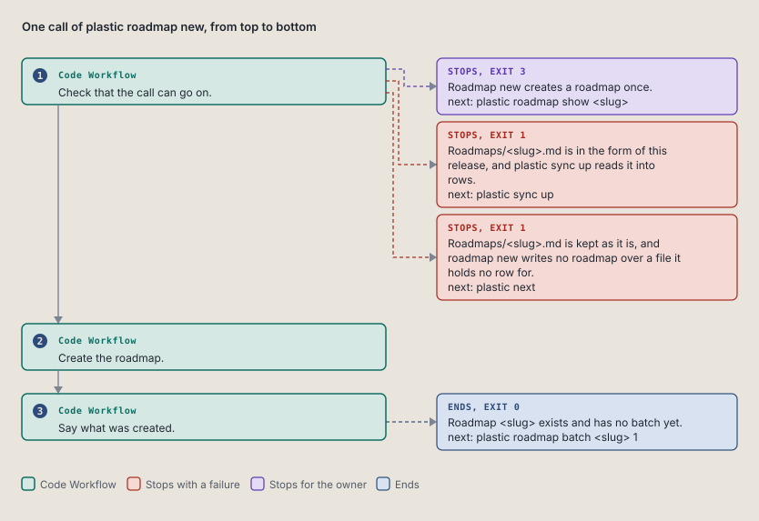

# plastic roadmap new

Create a roadmap; write its batches with roadmap batch.

```sh
plastic roadmap new NAME [--title TITLE] [--goal GOAL]
```

| Argument or option | What it gives | Default |
| --- | --- | --- |
| `NAME` | the roadmap's name | |
| `--title TITLE` | the roadmap's title; the name when absent |  |
| `--goal GOAL` | the roadmap's goal |  |

## The events of one call, step by step



The boxes on the left run in order. The boxes on the right are the ways the call stops or ends at that step.

## What one call changes

| What changes | Where | Reach |
| --- | --- | --- |
| The roadmap is created | the work graph database, in the store folder | goes with the store |
| The files of the roadmap are rewritten | the store folder | goes with the store |

Goes with the store: the files of the store carry the change, and `plastic sync up` rebuilds it on another machine. The database files themselves stay on this machine.

The command is `Plastic::Commands::Roadmap::New`, in [`new.rb:9`](../../../../lib/plastic/commands/roadmap/new.rb#L9).
