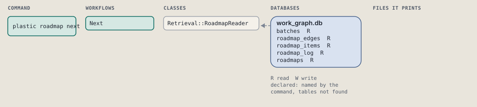
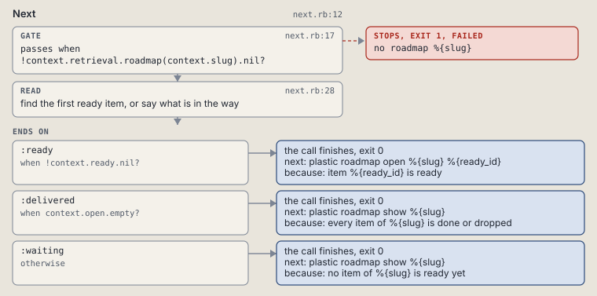

# plastic roadmap next

Print the first ready item, or what is in the way.

```sh
plastic roadmap next SLUG [--batch N]
```

The command is `Roadmap::Next`, in [`next.rb:9`](../../../../lib/plastic/commands/roadmap/next.rb#L9). The words on this page, such as gate, step and outcome, are explained in [the command DSL](../../dsl/README.md).

| Argument or option | What it gives | Default |
| --- | --- | --- |
| `SLUG` | the roadmap | |
| `--batch N` | only this batch |  |

## What it touches



## How the call flows


| Workflow | Kind | Code |
| --- | --- | --- |
| [Code::Roadmap::Next](#coderoadmapnext) | code | [`next.rb:12`](../../../../lib/plastic/workflows/code/roadmap/next.rb#L12) |

### Code::Roadmap::Next

The code workflow `:code_next_roadmap`, in [`next.rb:12`](../../../../lib/plastic/workflows/code/roadmap/next.rb#L12).

Finds the first ready item of a roadmap, ranked by batch then item position. With nothing ready, it names what is in flight and blocked.



| Step | Kind | Check | Code |
| --- | --- | --- | --- |
| no roadmap %{slug} | gate, stops with exit 1 | `!context.retrieval.roadmap(context.slug).nil?` | [`next.rb:17`](../../../../lib/plastic/workflows/code/roadmap/next.rb#L17) |
| find the first ready item, or say what is in the way | read |  | [`next.rb:28`](../../../../lib/plastic/workflows/code/roadmap/next.rb#L28) |

| Outcome | When | Then | Code |
| --- | --- | --- | --- |
| `:ready` | when `!context.ready.nil?` | finishes, exit 0; next: plastic roadmap open %{slug} %{ready_id} | [`next.rb:45`](../../../../lib/plastic/workflows/code/roadmap/next.rb#L45) |
| `:delivered` | when `context.open.empty?` | finishes, exit 0; next: plastic roadmap show %{slug} | [`next.rb:47`](../../../../lib/plastic/workflows/code/roadmap/next.rb#L47) |
| `:waiting` | otherwise | finishes, exit 0; next: plastic roadmap show %{slug} | [`next.rb:49`](../../../../lib/plastic/workflows/code/roadmap/next.rb#L49) |

It sets `ready`, `ready_id`, `open`.

## Outcomes

Every call can also end in [the ways any call can end](../../dsl/README.md#how-any-call-can-end).

| Ending | Exit | next: | Code |
| --- | --- | --- | --- |
| no roadmap %{slug} | 1 | prints no next: line | [`next.rb:17`](../../../../lib/plastic/workflows/code/roadmap/next.rb#L17) |
| item %{ready_id} is ready | 0 | plastic roadmap open %{slug} %{ready_id} | [`next.rb:45`](../../../../lib/plastic/workflows/code/roadmap/next.rb#L45) |
| every item of %{slug} is done or dropped | 0 | plastic roadmap show %{slug} | [`next.rb:47`](../../../../lib/plastic/workflows/code/roadmap/next.rb#L47) |
| no item of %{slug} is ready yet | 0 | plastic roadmap show %{slug} | [`next.rb:49`](../../../../lib/plastic/workflows/code/roadmap/next.rb#L49) |
| a step raises | 1 | prints no next: line | [`code_workflow.rb:102`](../../../../lib/plastic/code_workflow.rb#L102) |
