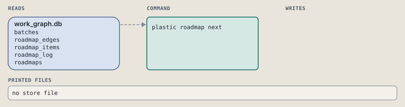

# plastic roadmap next

Print the first ready item, or what is in the way.

```sh
plastic roadmap next SLUG [--batch N]
```

The command is `Roadmap::Next`, in [`next.rb:9`](../../../../lib/plastic/commands/roadmap/next.rb#L9). The words on this page, such as gate, step and outcome, are explained in [the command DSL](../../dsl/README.md).

| Argument or option | What it gives | Default |
| --- | --- | --- |
| `SLUG` | the roadmap | |
| `--batch N` | only this batch |  |

## Components


The figure shows the command, the workflows it runs, the classes behind them, and the databases and files they reach.

## The events of one call

The call starts the workflow `Code::Roadmap::Next`, in [`next.rb:12`](../../../../lib/plastic/workflows/code/roadmap/next.rb#L12).

Finds the first ready item of a roadmap, ranked by batch then item position. With nothing ready, it names what is in flight and blocked.


Its rows run in this order:

1. Gate: passes when `!context.retrieval.roadmap(context.slug).nil?`; otherwise the call stops with exit 1 and prints no roadmap SLUG. [`next.rb:17`](../../../../lib/plastic/workflows/code/roadmap/next.rb#L17)
2. Read: find the first ready item, or say what is in the way. [`next.rb:28`](../../../../lib/plastic/workflows/code/roadmap/next.rb#L28)
3. Outcome `:ready`, when `!context.ready.nil?`: finishes with exit 0; next: plastic roadmap open SLUG READY_ID. [`next.rb:45`](../../../../lib/plastic/workflows/code/roadmap/next.rb#L45)
4. Outcome `:delivered`, when `context.open.empty?`: finishes with exit 0; next: plastic roadmap show SLUG. [`next.rb:47`](../../../../lib/plastic/workflows/code/roadmap/next.rb#L47)
5. Outcome `:waiting`, otherwise: finishes with exit 0; next: plastic roadmap show SLUG. [`next.rb:49`](../../../../lib/plastic/workflows/code/roadmap/next.rb#L49)

It sets `ready`, `ready_id`, `open`.

In the words of workflow engines, the rows are these four parts:

- **Trigger**: the call starts the workflow `Code::Roadmap::Next`.
- **Activities**: 1 read.
- **Transitions**: 1 gate stops the call when its check fails.
- **Outcomes**: `:ready`, `:delivered`, `:waiting` end the call.

## What one call reads, writes and prints



| Place | Database or file | Tables | Reads or writes | Code |
| --- | --- | --- | --- | --- |
| the store folder | work_graph.db | `batches`, `roadmap_edges`, `roadmap_items`, `roadmap_log`, `roadmaps` | reads | [`next.rb:13`](../../../../lib/plastic/commands/roadmap/next.rb#L13) |

## How a call ends

Every call can also end in [the ways any call can end](../../dsl/README.md#how-any-call-can-end).

| Ending | Exit | next: | Code |
| --- | --- | --- | --- |
| no roadmap SLUG | 1 | prints no next: line | [`next.rb:17`](../../../../lib/plastic/workflows/code/roadmap/next.rb#L17) |
| item READY_ID is ready | 0 | plastic roadmap open SLUG READY_ID | [`next.rb:45`](../../../../lib/plastic/workflows/code/roadmap/next.rb#L45) |
| every item of SLUG is done or dropped | 0 | plastic roadmap show SLUG | [`next.rb:47`](../../../../lib/plastic/workflows/code/roadmap/next.rb#L47) |
| no item of SLUG is ready yet | 0 | plastic roadmap show SLUG | [`next.rb:49`](../../../../lib/plastic/workflows/code/roadmap/next.rb#L49) |
| a step raises | 1 | prints no next: line | [`code_workflow.rb:102`](../../../../lib/plastic/code_workflow.rb#L102) |

## What the page leaves out

Every call shares a few things that this page does not repeat; [the command DSL](../../dsl/README.md#what-every-call-shares) names them.

- No gate of this command refuses, so exit 3 never happens.
