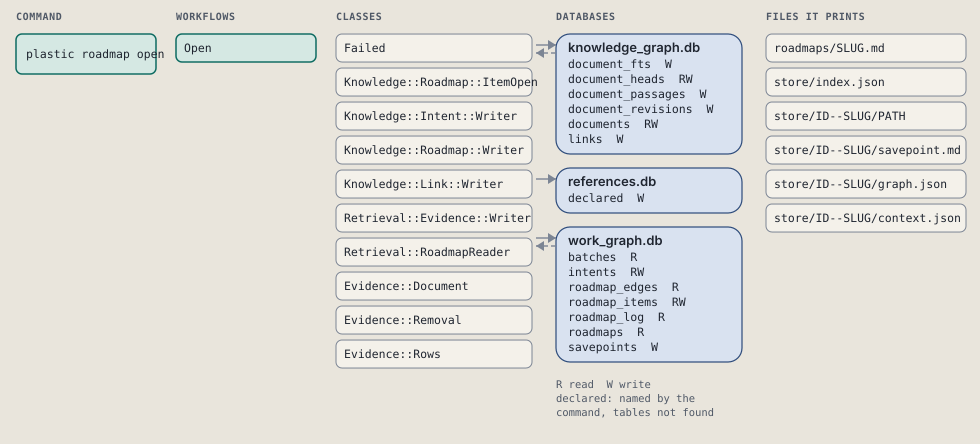
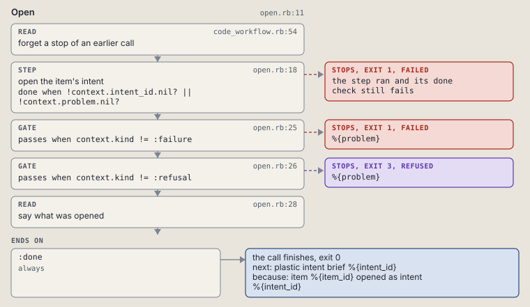
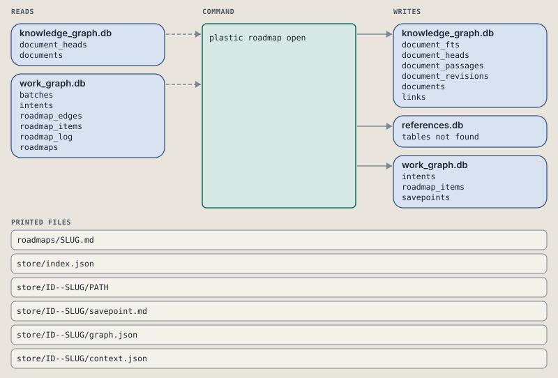

# plastic roadmap open

Open a ready item's intent, with its spec held in rows.

```sh
plastic roadmap open SLUG ITEM
```

The command is `Roadmap::Open`, in [`open.rb:9`](../../../../lib/plastic/commands/roadmap/open.rb#L9). The words on this page, such as gate, step and outcome, are explained in [the command DSL](../../dsl/README.md).

| Argument or option | What it gives | Default |
| --- | --- | --- |
| `SLUG` | the roadmap | |
| `ITEM` | the item to open | |

## Components



The figure shows the command, the workflows it runs, the classes behind them, and the databases and files they reach.

## The events of one call

The call starts the workflow `Code::Roadmap::Open`, in [`open.rb:11`](../../../../lib/plastic/workflows/code/roadmap/open.rb#L11).

Opens a ready item's intent, its spec.md holding the batch and item's goal and done criteria, then links the intent to the roadmap.



Its rows run in this order:

1. Read: forget a stop of an earlier call. [`code_workflow.rb:54`](../../../../lib/plastic/code_workflow.rb#L54)
2. Step: open the item's intent. Done when `!context.intent_id.nil? || !context.problem.nil?`, so a second call skips it. [`open.rb:18`](../../../../lib/plastic/workflows/code/roadmap/open.rb#L18)
3. Gate: passes when `context.kind != :failure`; otherwise the call stops with exit 1 and prints PROBLEM. [`open.rb:25`](../../../../lib/plastic/workflows/code/roadmap/open.rb#L25)
4. Gate: passes when `context.kind != :refusal`; otherwise the call stops with exit 3 and prints PROBLEM. [`open.rb:26`](../../../../lib/plastic/workflows/code/roadmap/open.rb#L26)
5. Read: say what was opened. [`open.rb:28`](../../../../lib/plastic/workflows/code/roadmap/open.rb#L28)
6. Outcome `:done`, always: finishes with exit 0; next: plastic intent brief INTENT_ID. [`open.rb:32`](../../../../lib/plastic/workflows/code/roadmap/open.rb#L32)

It sets `problem`, `kind`, `intent_id`.

In the words of workflow engines, the rows are these four parts:

- **Trigger**: the call starts the workflow `Code::Roadmap::Open`.
- **Activities**: 2 reads and 1 step.
- **Transitions**: 2 gates stop the call when their checks fail; a step runs only while its done check fails.
- **Outcomes**: `:done` end the call.

## What one call reads, writes and prints



| Place | Database or file | Tables | Reads or writes | Code |
| --- | --- | --- | --- | --- |
| the store folder | knowledge_graph.db | `document_fts`, `document_heads`, `document_passages`, `document_revisions`, `documents`, `links` | reads and writes | [`open.rb:13`](../../../../lib/plastic/commands/roadmap/open.rb#L13) |
| the store folder | references.db | not found in the code | writes | [`open.rb:13`](../../../../lib/plastic/commands/roadmap/open.rb#L13) |
| the store folder | work_graph.db | `batches`, `intents`, `roadmap_edges`, `roadmap_items`, `roadmap_log`, `roadmaps`, `savepoints` | reads and writes | [`open.rb:13`](../../../../lib/plastic/commands/roadmap/open.rb#L13) |
| the store folder | roadmaps/SLUG.md | | writes | [`prints.rb:124`](../../../../lib/plastic/graph/prints.rb#L124) |
| the store folder | store/index.json | | writes | [`prints.rb:14`](../../../../lib/plastic/graph/prints.rb#L14) |
| the store folder | store/ID--SLUG/PATH | | writes | [`prints.rb:15`](../../../../lib/plastic/graph/prints.rb#L15) |
| the store folder | store/ID--SLUG/savepoint.md | | writes | [`prints.rb:16`](../../../../lib/plastic/graph/prints.rb#L16) |
| the store folder | store/ID--SLUG/graph.json | | writes | [`prints.rb:17`](../../../../lib/plastic/graph/prints.rb#L17) |
| the store folder | store/ID--SLUG/context.json | | writes | [`prints.rb:18`](../../../../lib/plastic/graph/prints.rb#L18) |

A second call runs the same rows again. A step runs again only when its done check fails.

| Step | Done when | The second call | Code |
| --- | --- | --- | --- |
| open the item's intent | `!context.intent_id.nil? \|\| !context.problem.nil?` | skips it | [`open.rb:18`](../../../../lib/plastic/workflows/code/roadmap/open.rb#L18) |

## How a call ends

Every call can also end in [the ways any call can end](../../dsl/README.md#how-any-call-can-end).

| Ending | Exit | next: | Code |
| --- | --- | --- | --- |
| PROBLEM | 1 | prints no next: line | [`open.rb:25`](../../../../lib/plastic/workflows/code/roadmap/open.rb#L25) |
| PROBLEM | 3 | prints no next: line | [`open.rb:26`](../../../../lib/plastic/workflows/code/roadmap/open.rb#L26) |
| item ITEM_ID opened as intent INTENT_ID | 0 | plastic intent brief INTENT_ID | [`open.rb:32`](../../../../lib/plastic/workflows/code/roadmap/open.rb#L32) |
| a step raises | 1 | prints no next: line | [`code_workflow.rb:102`](../../../../lib/plastic/code_workflow.rb#L102) |

## What the page leaves out

Every call shares a few things that this page does not repeat; [the command DSL](../../dsl/README.md#what-every-call-shares) names them.

- A call that writes saves a routine run row in local.db. A stop by a gate or a step saves the run, and the next call resumes from it. A dry run saves no row.
