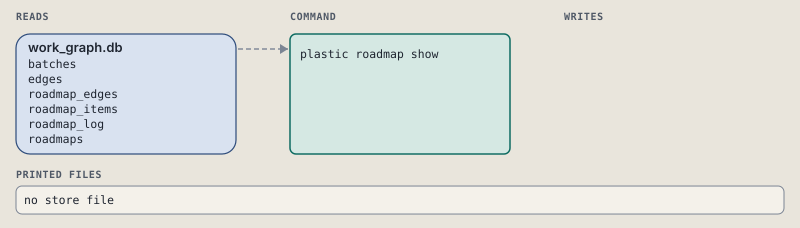

# plastic roadmap show

Print a roadmap's batches and items.

Prints a roadmap's batches and items from the rows. It reads and writes nothing.

```sh
plastic roadmap show SLUG [--batch N]
```

The command is `Roadmap::Show`, in [`show.rb:9`](../../../../lib/plastic/commands/roadmap/show.rb#L9). The words on this page, such as gate, step and outcome, are explained in [the command DSL](../../dsl/README.md).

| Argument or option | What it gives | Default |
| --- | --- | --- |
| `SLUG` | the roadmap | |
| `--batch N` | only this batch |  |

## Components


The figure shows the command, the workflows it runs, the classes behind them, and the databases and files they reach.

## The events of one call

The call starts the workflow `Code::Roadmap::Show`, in [`show.rb:12`](../../../../lib/plastic/workflows/code/roadmap/show.rb#L12).

Prints each batch with its goal and done criteria, then each item with its derived state, from the rows.


Its rows run in this order:

1. Gate: passes when `!context.retrieval.roadmap(context.slug).nil?`; otherwise the call stops with exit 1 and prints no roadmap SLUG. [`show.rb:15`](../../../../lib/plastic/workflows/code/roadmap/show.rb#L15)
2. Read: print each batch and item. [`show.rb:17`](../../../../lib/plastic/workflows/code/roadmap/show.rb#L17)
3. Outcome `:done`, always: finishes with exit 0; next: plastic roadmap next SLUG. [`show.rb:21`](../../../../lib/plastic/workflows/code/roadmap/show.rb#L21)

In the words of workflow engines, the rows are these four parts:

- **Trigger**: the call starts the workflow `Code::Roadmap::Show`.
- **Activities**: 1 read.
- **Transitions**: 1 gate stops the call when its check fails.
- **Outcomes**: `:done` ends the call.

## What one call reads, writes and prints



| Place | Database or file | Tables | Reads or writes | Code |
| --- | --- | --- | --- | --- |
| the store folder | work_graph.db | `batches`, `edges`, `roadmap_edges`, `roadmap_items`, `roadmap_log`, `roadmaps` | reads | [`show.rb:13`](../../../../lib/plastic/commands/roadmap/show.rb#L13) |

## How a call ends

Every call can also end in [the ways any call can end](../../dsl/README.md#how-any-call-can-end).

| Ending | Exit | next: | Code |
| --- | --- | --- | --- |
| no roadmap SLUG | 1 | prints no next: line | [`show.rb:15`](../../../../lib/plastic/workflows/code/roadmap/show.rb#L15) |
| the rows hold this roadmap | 0 | plastic roadmap next SLUG | [`show.rb:21`](../../../../lib/plastic/workflows/code/roadmap/show.rb#L21) |
| a step raises | 1 | prints no next: line | [`code_workflow.rb:102`](../../../../lib/plastic/code_workflow.rb#L102) |

## What the page leaves out

Every call shares a few things that this page does not repeat; [the command DSL](../../dsl/README.md#what-every-call-shares) names them.

- No gate of this command refuses, so exit 3 never happens.
