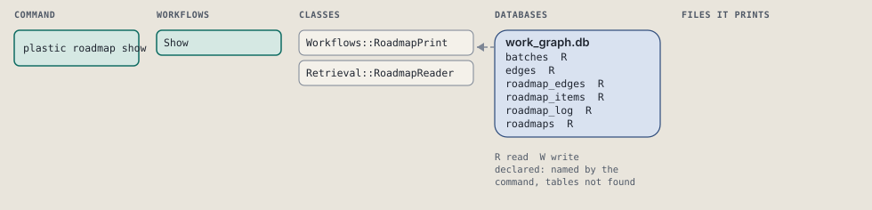
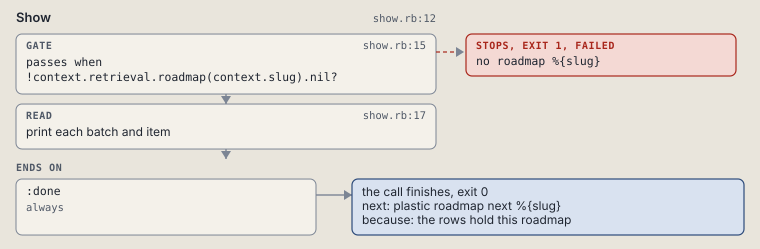

# plastic roadmap show

Print a roadmap's batches and items.

Prints a roadmap's batches and items from the rows. It reads and writes nothing.

```sh
plastic roadmap show SLUG [--batch N]
```

The command is `Roadmap::Show`, in [`show.rb:9`](../../../../lib/plastic/commands/roadmap/show.rb#L9). The words on this page, such as gate, step and outcome, are explained in [the command DSL](../../dsl/README.md).

| Argument or option | What it gives | Default |
| --- | --- | --- |
| `SLUG` | the roadmap | |
| `--batch N` | only this batch |  |

## What it touches



## How the call flows


| Workflow | Kind | Code |
| --- | --- | --- |
| [Code::Roadmap::Show](#coderoadmapshow) | code | [`show.rb:12`](../../../../lib/plastic/workflows/code/roadmap/show.rb#L12) |

### Code::Roadmap::Show

The code workflow `:code_show_roadmap`, in [`show.rb:12`](../../../../lib/plastic/workflows/code/roadmap/show.rb#L12).

Prints each batch with its goal and done criteria, then each item with its derived state, from the rows.



| Step | Kind | Check | Code |
| --- | --- | --- | --- |
| no roadmap %{slug} | gate, stops with exit 1 | `!context.retrieval.roadmap(context.slug).nil?` | [`show.rb:15`](../../../../lib/plastic/workflows/code/roadmap/show.rb#L15) |
| print each batch and item | read |  | [`show.rb:17`](../../../../lib/plastic/workflows/code/roadmap/show.rb#L17) |

| Outcome | When | Then | Code |
| --- | --- | --- | --- |
| `:done` | always | finishes, exit 0; next: plastic roadmap next %{slug} | [`show.rb:21`](../../../../lib/plastic/workflows/code/roadmap/show.rb#L21) |

## Outcomes

Every call can also end in [the ways any call can end](../../dsl/README.md#how-any-call-can-end).

| Ending | Exit | next: | Code |
| --- | --- | --- | --- |
| no roadmap %{slug} | 1 | prints no next: line | [`show.rb:15`](../../../../lib/plastic/workflows/code/roadmap/show.rb#L15) |
| the rows hold this roadmap | 0 | plastic roadmap next %{slug} | [`show.rb:21`](../../../../lib/plastic/workflows/code/roadmap/show.rb#L21) |
| a step raises | 1 | prints no next: line | [`code_workflow.rb:102`](../../../../lib/plastic/code_workflow.rb#L102) |
