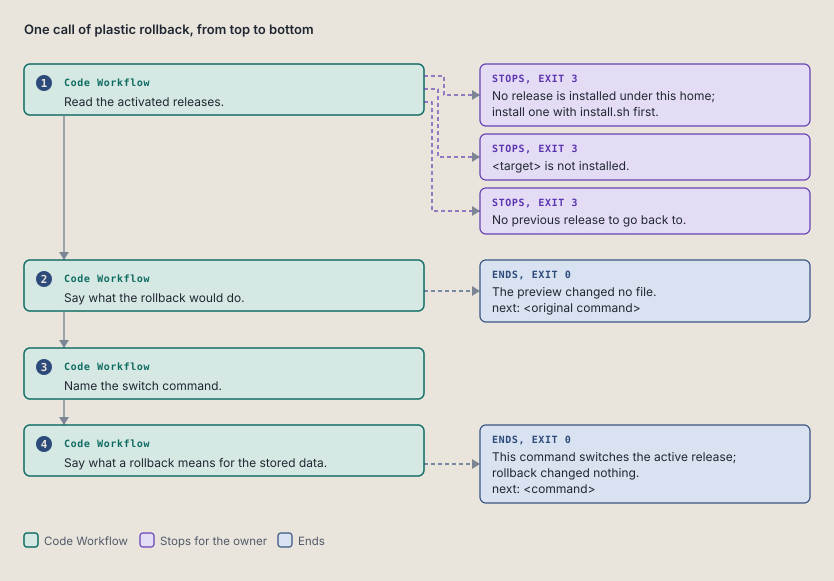

# plastic rollback

Switch the active release back to the previous one or to a named installed one.

```sh
plastic rollback [--version VERSION] [--dry-run]
```

| Argument or option | What it gives | Default |
| --- | --- | --- |
| `--version VERSION` | an installed release to switch to |  |
| `--dry-run` | name the switch and change nothing | `false` |

## The workflows of one call


Each box is a workflow. The words between the boxes say when the call moves on, and the last boxes say how the call ends.

## The events of one call, step by step



The boxes on the left run in order. The boxes on the right are the ways the call stops or ends at that step.

## What one call changes

This command changes nothing.

The command is `Plastic::Commands::Rollback`, in [`commands/rollback.rb`](../../../../lib/plastic/commands/rollback.rb).
