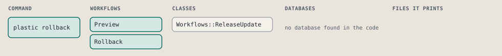
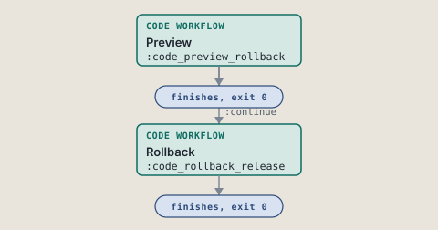
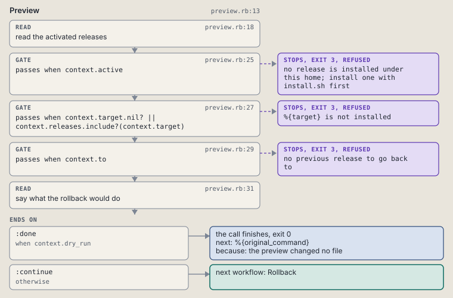
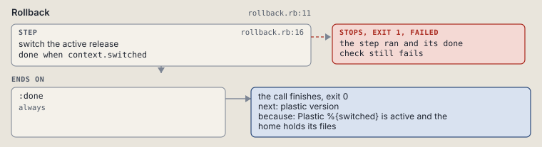
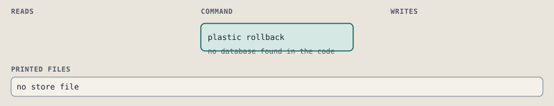

# plastic rollback

Switch the active release back to the previous one or to a named installed one.

```sh
plastic rollback [--version VERSION] [--dry-run]
```

The command is `Rollback`, in [`rollback.rb:9`](../../../../lib/plastic/commands/rollback.rb#L9). The words on this page, such as gate, step and outcome, are explained in [the command DSL](../../dsl/README.md).

| Argument or option | What it gives | Default |
| --- | --- | --- |
| `--version VERSION` | an installed release to switch to |  |
| `--dry-run` | name the switch and change nothing | `false` |

## Components



The figure shows the command, the workflows it runs, the classes behind them, and the databases and files they reach.

## The events of one call



| Workflow | Kind | Code |
| --- | --- | --- |
| [Code::Rollback::Preview](#coderollbackpreview) | code | [`preview.rb:13`](../../../../lib/plastic/workflows/code/rollback/preview.rb#L13) |
| [Code::Rollback](#coderollback) | code | [`rollback.rb:11`](../../../../lib/plastic/workflows/code/rollback.rb#L11) |

### Code::Rollback::Preview

The code workflow `:code_preview_rollback`, in [`preview.rb:13`](../../../../lib/plastic/workflows/code/rollback/preview.rb#L13).

Reads the activated releases and picks the one to switch to: the named version, or the previous release. A dry run names the switch.



Its rows run in this order:

1. Read: read the activated releases. [`preview.rb:18`](../../../../lib/plastic/workflows/code/rollback/preview.rb#L18)
2. Gate: passes when `context.active`; otherwise the call stops with exit 3 and prints no release is installed under this home; install one with install.sh first. [`preview.rb:25`](../../../../lib/plastic/workflows/code/rollback/preview.rb#L25)
3. Gate: passes when `context.target.nil? || context.releases.include?(context.target)`; otherwise the call stops with exit 3 and prints TARGET is not installed. [`preview.rb:27`](../../../../lib/plastic/workflows/code/rollback/preview.rb#L27)
4. Gate: passes when `context.to`; otherwise the call stops with exit 3 and prints no previous release to go back to. [`preview.rb:29`](../../../../lib/plastic/workflows/code/rollback/preview.rb#L29)
5. Read: say what the rollback would do. [`preview.rb:31`](../../../../lib/plastic/workflows/code/rollback/preview.rb#L31)
6. Outcome `:done`, when `context.dry_run`: finishes with exit 0; next: ORIGINAL_COMMAND. [`preview.rb:39`](../../../../lib/plastic/workflows/code/rollback/preview.rb#L39)
7. Outcome `:continue`, otherwise: starts the workflow [Code::Rollback](#coderollback). [`preview.rb:40`](../../../../lib/plastic/workflows/code/rollback/preview.rb#L40)

It sets `active`, `to`, `releases`.

### Code::Rollback

The code workflow `:code_rollback_release`, in [`rollback.rb:11`](../../../../lib/plastic/workflows/code/rollback.rb#L11).

Switches the active pointer to the named release or the previous one, and syncs that release's files into the home in the same activation.



Its rows run in this order:

1. Step: switch the active release. Done when `context.switched`, so a second call skips it. [`rollback.rb:16`](../../../../lib/plastic/workflows/code/rollback.rb#L16)
2. Outcome `:done`, always: finishes with exit 0; next: plastic version. [`rollback.rb:21`](../../../../lib/plastic/workflows/code/rollback.rb#L21)

It sets `switched`.

In the words of workflow engines, the rows are these four parts:

- **Trigger**: the call starts the workflow `Code::Rollback::Preview`; each later workflow starts from an outcome of the one before it.
- **Activities**: 2 reads and 1 step.
- **Transitions**: 3 gates stop the call when their checks fail; a step runs only while its done check fails; Preview goes to Rollback on `:continue`.
- **Outcomes**: `:done` of Preview, `:done` of Rollback end the call.

## What one call reads, writes and prints



It reads and writes no store database and prints no store file.

A second call runs the same rows again. A step runs again only when its done check fails.

| Step | Done when | The second call | Code |
| --- | --- | --- | --- |
| switch the active release | `context.switched` | skips it | [`rollback.rb:16`](../../../../lib/plastic/workflows/code/rollback.rb#L16) |

## How a call ends

Every call can also end in [the ways any call can end](../../dsl/README.md#how-any-call-can-end).

| Ending | Exit | next: | Code |
| --- | --- | --- | --- |
| no release is installed under this home; install one with install.sh first | 3 | prints no next: line | [`preview.rb:25`](../../../../lib/plastic/workflows/code/rollback/preview.rb#L25) |
| TARGET is not installed | 3 | prints no next: line | [`preview.rb:27`](../../../../lib/plastic/workflows/code/rollback/preview.rb#L27) |
| no previous release to go back to | 3 | prints no next: line | [`preview.rb:29`](../../../../lib/plastic/workflows/code/rollback/preview.rb#L29) |
| the preview changed no file | 0 | ORIGINAL_COMMAND | [`preview.rb:39`](../../../../lib/plastic/workflows/code/rollback/preview.rb#L39) |
| Plastic SWITCHED is active and the home holds its files | 0 | plastic version | [`rollback.rb:21`](../../../../lib/plastic/workflows/code/rollback.rb#L21) |
| a step raises | 1 | prints no next: line | [`code_workflow.rb:102`](../../../../lib/plastic/code_workflow.rb#L102) |

## What the page leaves out

Every call shares a few things that this page does not repeat; [the command DSL](../../dsl/README.md#what-every-call-shares) names them.
