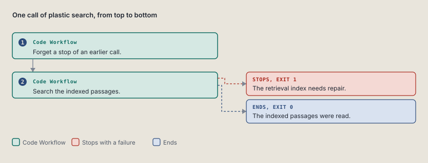

# plastic search

Search indexed passages across selected stores for the words of a question, best match first.

```sh
plastic search TERMS... [--source-project SLUG] [--limit N]
```

| Argument or option | What it gives | Default |
| --- | --- | --- |
| `TERMS` | the words of a question, ranked by BM25; quote a phrase to keep it whole | |
| `--source-project SLUG` | a source store | `[]` |
| `--limit N` | maximum passages | `20` |

## The events of one call, step by step



The boxes on the left run in order. The boxes on the right are the ways the call stops or ends at that step.

## What one call changes

This command changes nothing.

The command is `Plastic::Commands::Search`, in [`commands/search.rb`](../../../../lib/plastic/commands/search.rb).
