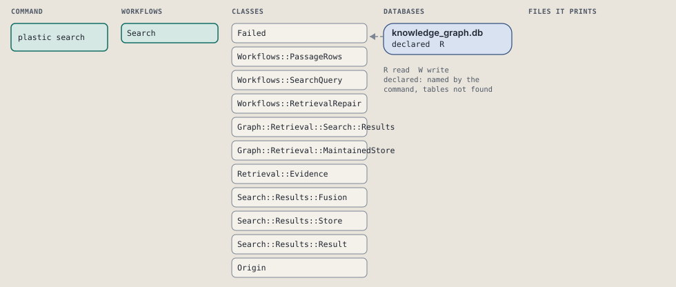
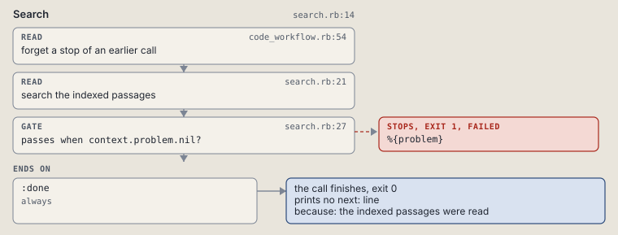
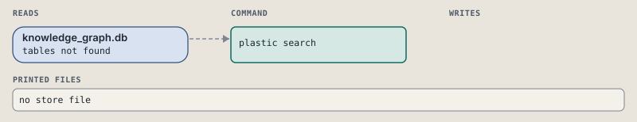

# plastic search

Search literal indexed passages across selected stores.

Searches literal indexed passages in the selected local stores.

```sh
plastic search TERMS... [--source-project SLUG] [--limit N]
```

The command is `Search`, in [`search.rb:8`](../../../../lib/plastic/commands/search.rb#L8). The words on this page, such as gate, step and outcome, are explained in [the command DSL](../../dsl/README.md).

| Argument or option | What it gives | Default |
| --- | --- | --- |
| `TERMS` | literal search terms | |
| `--source-project SLUG` | a source store | `[]` |
| `--limit N` | maximum passages | `20` |

## Components



The figure shows the command, the workflows it runs, the classes behind them, and the databases and files they reach.

## The events of one call

The call starts the workflow `Code::Search`, in [`search.rb:14`](../../../../lib/plastic/workflows/code/search.rb#L14).

Searches literal indexed passages in the selected local stores and reports them as one fused list.



Its rows run in this order:

1. Read: forget a stop of an earlier call. [`code_workflow.rb:54`](../../../../lib/plastic/code_workflow.rb#L54)
2. Read: search the indexed passages. [`search.rb:21`](../../../../lib/plastic/workflows/code/search.rb#L21)
3. Gate: passes when `context.problem.nil?`; otherwise the call stops with exit 1 and prints PROBLEM. [`search.rb:27`](../../../../lib/plastic/workflows/code/search.rb#L27)
4. Outcome `:done`, always: finishes with exit 0; prints no next: line. [`search.rb:29`](../../../../lib/plastic/workflows/code/search.rb#L29)

It sets `problem`.

In the words of workflow engines, the rows are these four parts:

- **Trigger**: the call starts the workflow `Code::Search`.
- **Activities**: 2 reads.
- **Transitions**: 1 gate stops the call when its check fails.
- **Outcomes**: `:done` end the call.

## What one call reads, writes and prints



| Place | Database or file | Tables | Reads or writes | Code |
| --- | --- | --- | --- | --- |
| the store folder | knowledge_graph.db | not found in the code | reads | [`search.rb:12`](../../../../lib/plastic/commands/search.rb#L12) |

## How a call ends

Every call can also end in [the ways any call can end](../../dsl/README.md#how-any-call-can-end).

| Ending | Exit | next: | Code |
| --- | --- | --- | --- |
| PROBLEM | 1 | prints no next: line | [`search.rb:27`](../../../../lib/plastic/workflows/code/search.rb#L27) |
| the indexed passages were read | 0 | prints no next: line | [`search.rb:29`](../../../../lib/plastic/workflows/code/search.rb#L29) |
| a step raises | 1 | prints no next: line | [`code_workflow.rb:102`](../../../../lib/plastic/code_workflow.rb#L102) |

## What the page leaves out

Every call shares a few things that this page does not repeat; [the command DSL](../../dsl/README.md#what-every-call-shares) names them.

- No gate of this command refuses, so exit 3 never happens.
