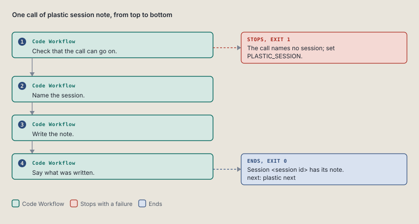

# plastic session note

Write the one prose line of this session.

```sh
plastic session note TEXT...
```

| Argument or option | What it gives | Default |
| --- | --- | --- |
| `TEXT` | the note, in words | |

## The events of one call, step by step



The boxes on the left run in order. The boxes on the right are the ways the call stops or ends at that step.

## What one call changes

| What changes | Where | Reach |
| --- | --- | --- |
| The note is added to the session | the local database, in the home folder | stays on this machine |
| The run of the call is kept for a resume | the work graph database, in the store folder | stays on this machine |

The command is `Plastic::Commands::Session::Note`, in [`note.rb:9`](../../../../lib/plastic/commands/session/note.rb#L9).
