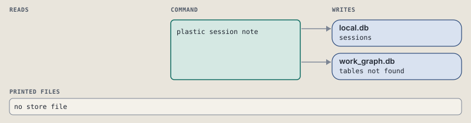

# plastic session note

Write the one prose line of this session.

```sh
plastic session note TEXT...
```

The command is `Session::Note`, in [`note.rb:9`](../../../../lib/plastic/commands/session/note.rb#L9). The words on this page, such as gate, step and outcome, are explained in [the command DSL](../../dsl/README.md).

| Argument or option | What it gives | Default |
| --- | --- | --- |
| `TEXT` | the note, in words | |

## Components


The figure shows the command, the workflows it runs, the classes behind them, and the databases and files they reach.

## The events of one call

The call starts the workflow `Code::Session::Note`, in [`note.rb:10`](../../../../lib/plastic/workflows/code/session/note.rb#L10).

Writes the one prose line of a session.


Its rows run in this order:

1. Gate: passes when `!context.session.nil?`; otherwise the call stops with exit 1 and prints the call names no session; set PLASTIC_SESSION. [`note.rb:15`](../../../../lib/plastic/workflows/code/session/note.rb#L15)
2. Read: name the session. [`note.rb:17`](../../../../lib/plastic/workflows/code/session/note.rb#L17)
3. Step: write the note. Done when `context.written`, so a second call skips it. [`note.rb:21`](../../../../lib/plastic/workflows/code/session/note.rb#L21)
4. Read: say what was written. [`note.rb:26`](../../../../lib/plastic/workflows/code/session/note.rb#L26)
5. Outcome `:done`, always: finishes with exit 0; next: plastic next. [`note.rb:30`](../../../../lib/plastic/workflows/code/session/note.rb#L30)

It sets `session_id`, `written`.

In the words of workflow engines, the rows are these four parts:

- **Trigger**: the call starts the workflow `Code::Session::Note`.
- **Activities**: 2 reads and 1 step.
- **Transitions**: 1 gate stops the call when its check fails; a step runs only while its done check fails.
- **Outcomes**: `:done` ends the call.

## What one call reads, writes and prints



| Place | Database or file | Tables | Reads or writes | Code |
| --- | --- | --- | --- | --- |
| the home folder | local.db | `sessions` | writes | found in the code, not declared |
| the store folder | work_graph.db | not found in the code | writes | [`note.rb:11`](../../../../lib/plastic/commands/session/note.rb#L11) |

A second call runs the same rows again. A step runs again only when its done check fails.

| Step | Done when | The second call | Code |
| --- | --- | --- | --- |
| write the note | `context.written` | skips it | [`note.rb:21`](../../../../lib/plastic/workflows/code/session/note.rb#L21) |

## How a call ends

Every call can also end in [the ways any call can end](../../dsl/README.md#how-any-call-can-end).

| Ending | Exit | next: | Code |
| --- | --- | --- | --- |
| the call names no session; set PLASTIC_SESSION | 1 | prints no next: line | [`note.rb:15`](../../../../lib/plastic/workflows/code/session/note.rb#L15) |
| session SESSION_ID has its note | 0 | plastic next | [`note.rb:30`](../../../../lib/plastic/workflows/code/session/note.rb#L30) |
| a step raises | 1 | prints no next: line | [`code_workflow.rb:102`](../../../../lib/plastic/code_workflow.rb#L102) |

## What the page leaves out

Every call shares a few things that this page does not repeat; [the command DSL](../../dsl/README.md#what-every-call-shares) names them.

- No gate of this command refuses, so exit 3 never happens.
- A call that writes saves a routine run row in local.db. A stop by a gate or a step saves the run, and the next call resumes from it. A dry run saves no row.
