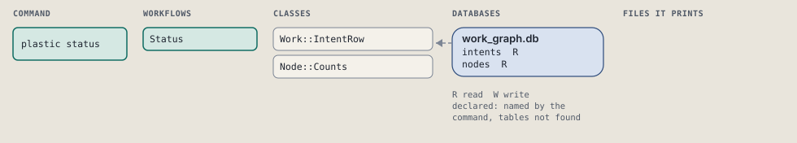
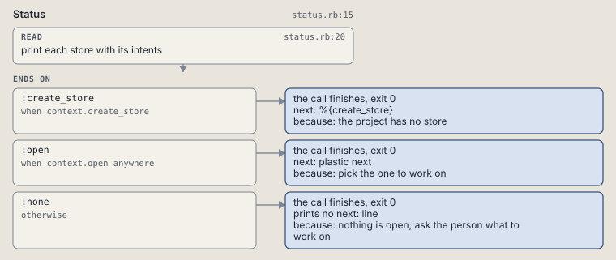
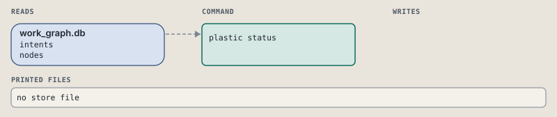

# plastic status

List every store's intents by group, with node counts by state.

```sh
plastic status
```

The command is `Status`, in [`status.rb:9`](../../../../lib/plastic/commands/status.rb#L9). The words on this page, such as gate, step and outcome, are explained in [the command DSL](../../dsl/README.md).

## Components



The figure shows the command, the workflows it runs, the classes behind them, and the databases and files they reach.

## The events of one call

The call starts the workflow `Code::Status`, in [`status.rb:15`](../../../../lib/plastic/workflows/code/status.rb#L15).

Every store under the Plastic home, its intents by group, and their node counts by state. It opens each store itself.



Its rows run in this order:

1. Read: print each store with its intents. [`status.rb:20`](../../../../lib/plastic/workflows/code/status.rb#L20)
2. Outcome `:create_store`, when `context.create_store`: finishes with exit 0; next: CREATE_STORE. [`status.rb:29`](../../../../lib/plastic/workflows/code/status.rb#L29)
3. Outcome `:open`, when `context.open_anywhere`: finishes with exit 0; next: plastic next. [`status.rb:30`](../../../../lib/plastic/workflows/code/status.rb#L30)
4. Outcome `:none`, otherwise: finishes with exit 0; prints no next: line. [`status.rb:31`](../../../../lib/plastic/workflows/code/status.rb#L31)

It sets `create_store`, `open_anywhere`.

In the words of workflow engines, the rows are these four parts:

- **Trigger**: the call starts the workflow `Code::Status`.
- **Activities**: 1 read.
- **Transitions**: .
- **Outcomes**: `:create_store`, `:open`, `:none` end the call.

## What one call reads, writes and prints



| Place | Database or file | Tables | Reads or writes | Code |
| --- | --- | --- | --- | --- |
| the store folder | work_graph.db | `intents`, `nodes` | reads | found in the code, not declared |

## How a call ends

Every call can also end in [the ways any call can end](../../dsl/README.md#how-any-call-can-end).

| Ending | Exit | next: | Code |
| --- | --- | --- | --- |
| the project has no store | 0 | CREATE_STORE | [`status.rb:29`](../../../../lib/plastic/workflows/code/status.rb#L29) |
| pick the one to work on | 0 | plastic next | [`status.rb:30`](../../../../lib/plastic/workflows/code/status.rb#L30) |
| nothing is open; ask the person what to work on | 0 | prints no next: line | [`status.rb:31`](../../../../lib/plastic/workflows/code/status.rb#L31) |
| a step raises | 1 | prints no next: line | [`code_workflow.rb:107`](../../../../lib/plastic/code_workflow.rb#L107) |

## What the page leaves out

Every call shares a few things that this page does not repeat; [the command DSL](../../dsl/README.md#what-every-call-shares) names them.

- No gate of this command refuses, so exit 3 never happens.
