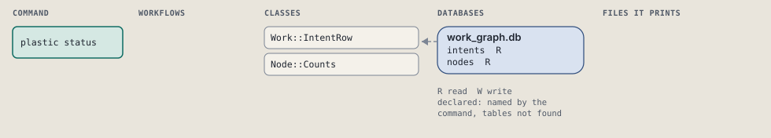
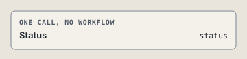
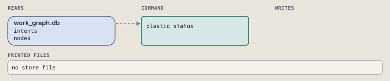

# plastic status

List every store's open and active intents, with node counts by state.

```sh
plastic status
```

The command is `Status`, in [`status.rb:12`](../../../../lib/plastic/commands/status.rb#L12). The words on this page, such as gate, step and outcome, are explained in [the command DSL](../../dsl/README.md).

## Components



The figure shows the command, the workflows it runs, the classes behind them, and the databases and files they reach.

## The events of one call



The command's `call`, at [`status.rb:15`](../../../../lib/plastic/commands/status.rb#L15):

```ruby
def call
  projects = scope.projects
  shown = slugs.map { |slug| store_rows(slug, projects) }
  output.rows(shown.flat_map(&:first))
  offer_next(shown.filter_map(&:last).first)
end
```

Its steps run in this order:

1. `projects = scope.projects` [`status.rb:16`](../../../../lib/plastic/commands/status.rb#L16)
2. `shown = slugs.map { |slug| store_rows(slug, projects) }` [`status.rb:17`](../../../../lib/plastic/commands/status.rb#L17)
3. `output.rows(shown.flat_map(&:first))` [`status.rb:18`](../../../../lib/plastic/commands/status.rb#L18)
4. `offer_next(shown.filter_map(&:last).first)` [`status.rb:19`](../../../../lib/plastic/commands/status.rb#L19)

## What one call reads, writes and prints



| Place | Database or file | Tables | Reads or writes | Code |
| --- | --- | --- | --- | --- |
| the store folder | work_graph.db | `intents`, `nodes` | reads | [`status.rb:13`](../../../../lib/plastic/commands/status.rb#L13) |

## How a call ends

Every call can also end in [the ways any call can end](../../dsl/README.md#how-any-call-can-end).

| Ending | Exit | next: | Code |
| --- | --- | --- | --- |
| Offers the next command | 0 | plastic next | [`status.rb:27`](../../../../lib/plastic/commands/status.rb#L27) |
| Offers the next command | 0 | decided at run time | [`status.rb:29`](../../../../lib/plastic/commands/status.rb#L29) |

## What the page leaves out

Every call shares a few things that this page does not repeat; [the command DSL](../../dsl/README.md#what-every-call-shares) names them.

- No gate of this command refuses, so exit 3 never happens.
