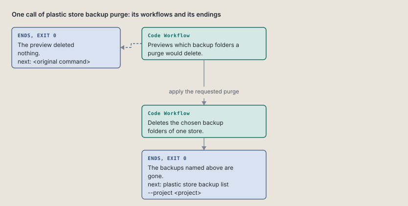
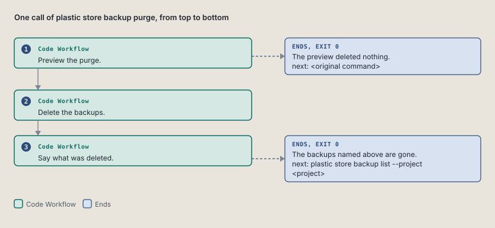

# plastic store backup purge

Delete one store's backups; give one of --all, --failed, --interrupted or --older-than.

```sh
plastic store backup purge (--older-than DATE | --all | --failed | --interrupted) [--dry-run]
```

| Argument or option | What it gives | Default |
| --- | --- | --- |
| `--older-than DATE` | delete the backups before this date or time |  |
| `--all` | delete every backup of the store | `false` |
| `--failed` | delete every backup whose status is failed | `false` |
| `--interrupted` | delete every backup in progress or with no status recorded for over five minutes, whether its run stopped or is only slow | `false` |
| `--dry-run` | list what would be deleted and delete nothing | `false` |

## The workflows of one call



Each box is a workflow. The words between the boxes say when the call moves on, and the last boxes say how the call ends.

## The events of one call, step by step



The boxes on the left run in order. The boxes on the right are the ways the call stops or ends at that step.

## What one call changes

| What changes | Where | Reach |
| --- | --- | --- |
| The chosen backup folders are deleted | the backups folder, in the store folder | stays on this machine |
| The run of the call is kept for a resume | the work graph database, in the store folder | stays on this machine |

The command is `Plastic::Commands::Store::Backup::Purge`, in [`commands/store/backup/purge.rb`](../../../../lib/plastic/commands/store/backup/purge.rb).
