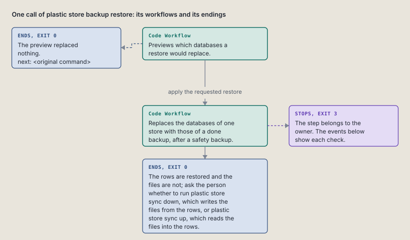
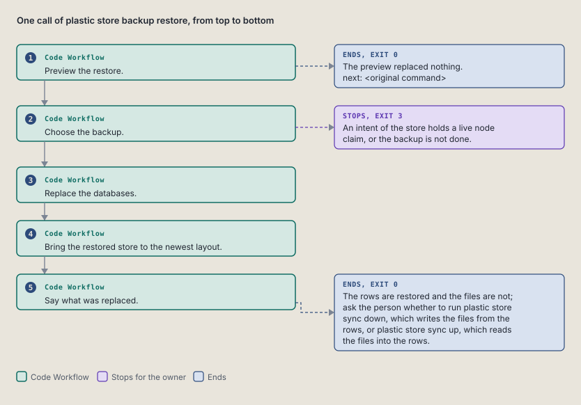

# plastic store backup restore

Replace one store's databases with those of a done backup.

```sh
plastic store backup restore [--timestamp TS] [--latest] [--databases LIST] [--dry-run]
```

| Argument or option | What it gives | Default |
| --- | --- | --- |
| `--timestamp TS` | the backup to restore, by its folder name |  |
| `--latest` | restore the newest done backup that holds a database file | `false` |
| `--databases LIST` | the databases to restore, comma separated; all the backup holds when left out |  |
| `--dry-run` | list what would be replaced and change nothing | `false` |

## The workflows of one call



Each box is a workflow. The words between the boxes say when the call moves on, and the last boxes say how the call ends.

## The events of one call, step by step



The boxes on the left run in order. The boxes on the right are the ways the call stops or ends at that step.

## What one call changes

| What changes | Where | Reach |
| --- | --- | --- |
| The chosen databases of the store are replaced by the copies of the backup folder | the database files of the store, in the store folder | stays on this machine |
| A safety backup of the replaced databases is written | the backups folder, in the store folder | stays on this machine |
| The restored databases are migrated to the newest layout | the database files of the store, in the store folder | stays on this machine |

The command is `Plastic::Commands::Store::Backup::Restore`, in [`commands/store/backup/restore.rb`](../../../../lib/plastic/commands/store/backup/restore.rb).
