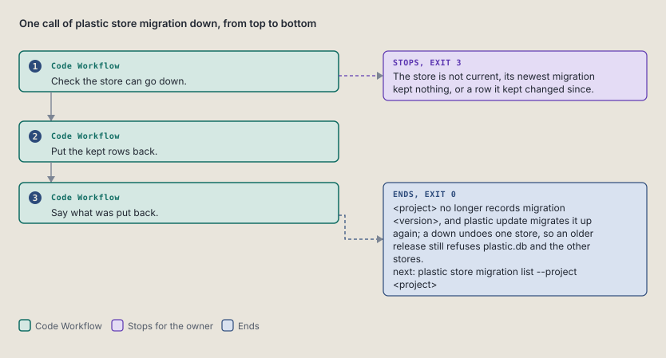

# plastic store migration down

Put back the rows the newest migration of one store kept in legacy.db and remove its version, after a backup.

```sh
plastic store migration down
```

## The events of one call, step by step



The boxes on the left run in order. The boxes on the right are the ways the call stops or ends at that step.

## What one call changes

| What changes | Where | Reach |
| --- | --- | --- |
| The rows the newest migration kept in legacy.db go back into the store, and its version goes | the database files of the store, in the store folder | stays on this machine |
| A backup of the store is written first | the backups folder, in the store folder | stays on this machine |

The command is `Plastic::Commands::Store::Migration::Down`, in [`commands/store/migration/down.rb`](../../../../lib/plastic/commands/store/migration/down.rb).
