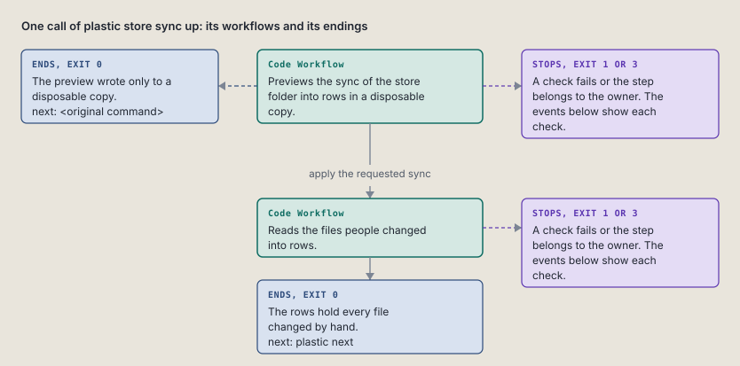
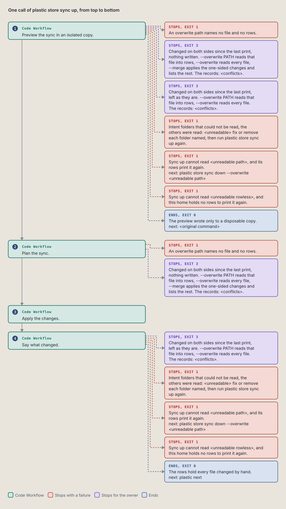

# plastic store sync up

Read the files changed by hand into rows.

```sh
plastic store sync up [--overwrite [PATH]] [--merge] [--dry-run]
```

| Argument or option | What it gives | Default |
| --- | --- | --- |
| `--overwrite [PATH]` | read the file of the path into rows, or every file with no path | `false` |
| `--merge` | apply the one-sided changes, then list the conflicts | `false` |
| `--dry-run` | preview the complete sync in a disposable copy | `false` |

## The workflows of one call



Each box is a workflow. The words between the boxes say when the call moves on, and the last boxes say how the call ends.

## The events of one call, step by step



The boxes on the left run in order. The boxes on the right are the ways the call stops or ends at that step.

## What one call changes

| What changes | Where | Reach |
| --- | --- | --- |
| The file types a sync skipped are recorded in the setting sync.asked, once each | the Plastic home folder | stays on this machine |
| The records of the intents whose files changed by hand are rewritten from the files | the work graph database, in the store folder | stays on this machine |
| The documents of those intents are rewritten from the files | the knowledge graph database, in the store folder | stays on this machine |
| The files of the intents and the index of the store are printed again from the rows | the store folder | goes with the store |
| The files kept in the store folder are read into the knowledge database | the knowledge graph database, in the store folder | stays on this machine |

Goes with the store: the files of the store carry the change, and `plastic store sync up` rebuilds it on another machine. The database files themselves stay on this machine.

The command is `Plastic::Commands::Store::Sync::Up`, in [`commands/store/sync/up.rb`](../../../../lib/plastic/commands/store/sync/up.rb).
