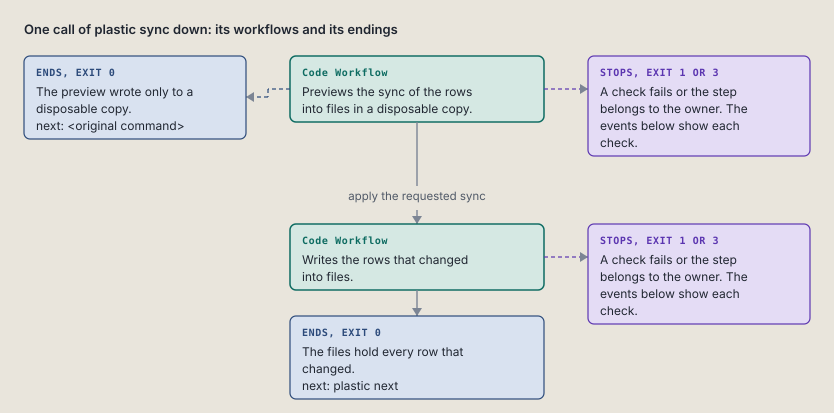
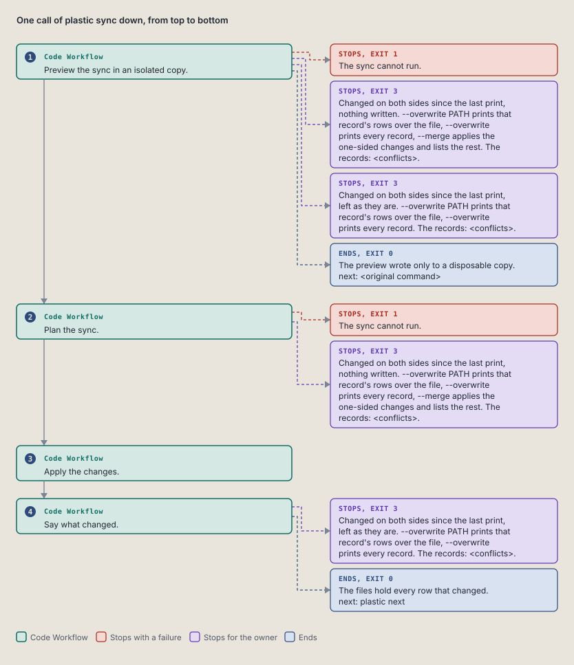

# plastic sync down

Write the rows that changed into files.

```sh
plastic sync down [--overwrite [PATH]] [--merge] [--dry-run]
```

| Argument or option | What it gives | Default |
| --- | --- | --- |
| `--overwrite [PATH]` | print the rows of the path over its file, or every record with no path | `false` |
| `--merge` | apply the one-sided changes, then list the conflicts | `false` |
| `--dry-run` | preview the complete sync in a disposable copy | `false` |

## The workflows of one call



Each box is a workflow. The words between the boxes say when the call moves on, and the last boxes say how the call ends.

## The events of one call, step by step



The boxes on the left run in order. The boxes on the right are the ways the call stops or ends at that step.

## What one call changes

| What changes | Where | Reach |
| --- | --- | --- |
| The files of the intents whose records changed are rewritten in the store folder | the store folder | goes with the store |

Goes with the store: the files of the store carry the change, and `plastic sync up` rebuilds it on another machine. The database files themselves stay on this machine.

The command is `Plastic::Commands::Sync::Down`, in [`down.rb:12`](../../../../lib/plastic/commands/sync/down.rb#L12).
