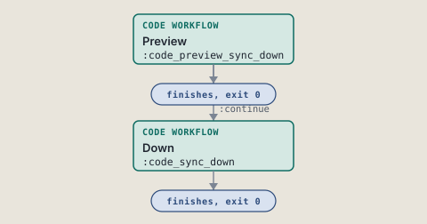

# plastic sync down

Write the rows that changed into files.

Writes the rows that changed into files. A record changed on both sides stops the call, exit 3, and every conflict is listed.

```sh
plastic sync down [--overwrite [PATH]] [--merge] [--dry-run]
```

The command is `Sync::Down`, in [`down.rb:12`](../../../../lib/plastic/commands/sync/down.rb#L12). The words on this page, such as gate, step and outcome, are explained in [the command DSL](../../dsl/README.md).

| Argument or option | What it gives | Default |
| --- | --- | --- |
| `--overwrite [PATH]` | settle conflicts on this side: one record by its path, or every record with no path | `false` |
| `--merge` | apply the one-sided changes, then list the conflicts | `false` |
| `--dry-run` | preview the complete sync in a disposable copy | `false` |

## What it touches


## How the call flows



| Workflow | Kind | Code |
| --- | --- | --- |
| [Code::Sync::Down::Preview](#codesyncdownpreview) | code | [`preview.rb:12`](../../../../lib/plastic/workflows/code/sync/down/preview.rb#L12) |
| [Code::Sync::Down](#codesyncdown) | code | [`down.rb:11`](../../../../lib/plastic/workflows/code/sync/down.rb#L11) |

### Code::Sync::Down::Preview

The code workflow `:code_preview_sync_down`, in [`preview.rb:12`](../../../../lib/plastic/workflows/code/sync/down/preview.rb#L12).

Previews sync down in a copy before the normal write workflow.


| Step | Kind | Check | Code |
| --- | --- | --- | --- |
| preview the sync | read |  | [`preview.rb:15`](../../../../lib/plastic/workflows/code/sync/down/preview.rb#L15) |

| Outcome | When | Then | Code |
| --- | --- | --- | --- |
| `:done` | when `context.dry_run` | finishes, exit 0; next: %{original_command} | [`preview.rb:23`](../../../../lib/plastic/workflows/code/sync/down/preview.rb#L23) |
| `:continue` | otherwise | runs [Code::Sync::Down](#codesyncdown) | [`preview.rb:25`](../../../../lib/plastic/workflows/code/sync/down/preview.rb#L25) |

### Code::Sync::Down

The code workflow `:code_sync_down`, in [`down.rb:11`](../../../../lib/plastic/workflows/code/sync/down.rb#L11).

Sync down: plans, applies, and refuses on the conflicts left.


| Step | Kind | Check | Code |
| --- | --- | --- | --- |
| plan the sync | read |  | [`sync_steps.rb:67`](../../../../lib/plastic/workflows/sync_steps.rb#L67) |
| %{failure} | gate, stops with exit 1 | `public_send(name, context)` | [`sync_steps.rb:68`](../../../../lib/plastic/workflows/sync_steps.rb#L68) |
| changed on both sides since the last print, nothing written: %{conflicts}; pass --overwrite PATH, --overwrite or --merge | gate, stops with exit 3 | `public_send(name, context)` | [`sync_steps.rb:69`](../../../../lib/plastic/workflows/sync_steps.rb#L69) |
| apply the changes | step | `plan(context, direction).pending.zero?` | [`sync_steps.rb:73`](../../../../lib/plastic/workflows/sync_steps.rb#L73) |
| say what changed | read |  | [`sync_steps.rb:74`](../../../../lib/plastic/workflows/sync_steps.rb#L74) |
| changed on both sides since the last print, left as they are: %{conflicts}; pass --overwrite PATH or --overwrite | gate, stops with exit 3 | `public_send(name, context)` | [`sync_steps.rb:75`](../../../../lib/plastic/workflows/sync_steps.rb#L75) |

| Outcome | When | Then | Code |
| --- | --- | --- | --- |
| `:done` | always | finishes, exit 0; next: plastic next | [`sync_steps.rb:63`](../../../../lib/plastic/workflows/sync_steps.rb#L63) |

It sets `failure`, `conflicts`, `merging`, `unreadable`, `lines`.

## Outcomes

Every call can also end in [the ways any call can end](../../dsl/README.md#how-any-call-can-end).

| Ending | Exit | next: | Code |
| --- | --- | --- | --- |
| the preview wrote only to a disposable copy | 0 | %{original_command} | [`preview.rb:23`](../../../../lib/plastic/workflows/code/sync/down/preview.rb#L23) |
| %{failure} | 1 | prints no next: line | [`sync_steps.rb:68`](../../../../lib/plastic/workflows/sync_steps.rb#L68) |
| changed on both sides since the last print, nothing written: %{conflicts}; pass --overwrite PATH, --overwrite or --merge | 3 | prints no next: line | [`sync_steps.rb:69`](../../../../lib/plastic/workflows/sync_steps.rb#L69) |
| changed on both sides since the last print, left as they are: %{conflicts}; pass --overwrite PATH or --overwrite | 3 | prints no next: line | [`sync_steps.rb:75`](../../../../lib/plastic/workflows/sync_steps.rb#L75) |
| the files hold every row that changed | 0 | plastic next | [`sync_steps.rb:63`](../../../../lib/plastic/workflows/sync_steps.rb#L63) |
| a step raises | 1 | prints no next: line | [`code_workflow.rb:102`](../../../../lib/plastic/code_workflow.rb#L102) |
