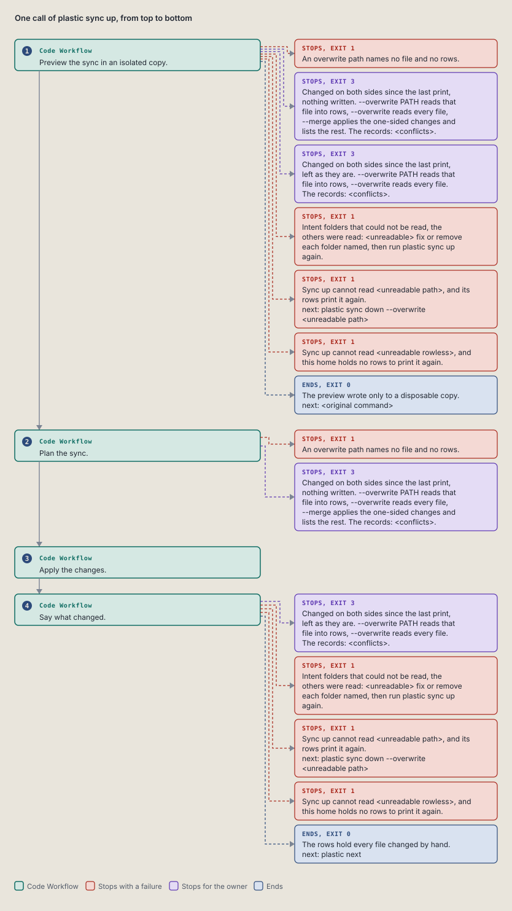

# plastic sync up

Read the files changed by hand into rows.

Reads the files people changed into rows. A record changed on both sides stops the call, exit 3, and every conflict is listed. With one home after the other and a copy of the files between, no change is lost; with a command on each home before the copy, the file that arrives takes the place of the change of the second home. An index that another home printed sets the title, the state, the disposition, the reason and the closed time of every intent it lists. So with a command on each home before the copy, it takes back a change of this home, also on an intent that the other home never changed. A file deleted on one home is printed again from rows on the other.

```sh
plastic sync up [--overwrite [PATH]] [--merge] [--dry-run]
```

| Argument or option | What it gives | Default |
| --- | --- | --- |
| `--overwrite [PATH]` | read the file of the path into rows, or every file with no path | `false` |
| `--merge` | apply the one-sided changes, then list the conflicts | `false` |
| `--dry-run` | preview the complete sync in a disposable copy | `false` |

## The workflows of one call


Each box is a workflow. The words between the boxes say when the call moves on, and the last boxes say how the call ends.

## The events of one call, step by step



The boxes on the left run in order. The boxes on the right are the ways the call stops or ends at that step.

## What one call changes

| What changes | Where | Reach |
| --- | --- | --- |
| The records of the intents whose files changed by hand are rewritten from the files | the work graph database, in the store folder | stays on this machine |
| The documents of those intents are rewritten from the files | the knowledge graph database, in the store folder | stays on this machine |
| The files kept in the store folder are read into the references database | the references database, in the store folder | stays on this machine |

The command is `Plastic::Commands::Sync::Up`, in [`up.rb:15`](../../../../lib/plastic/commands/sync/up.rb#L15).
