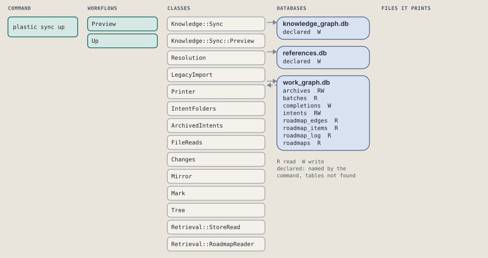
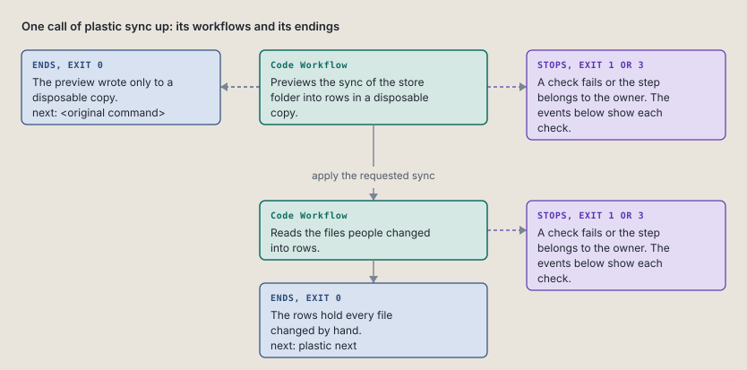
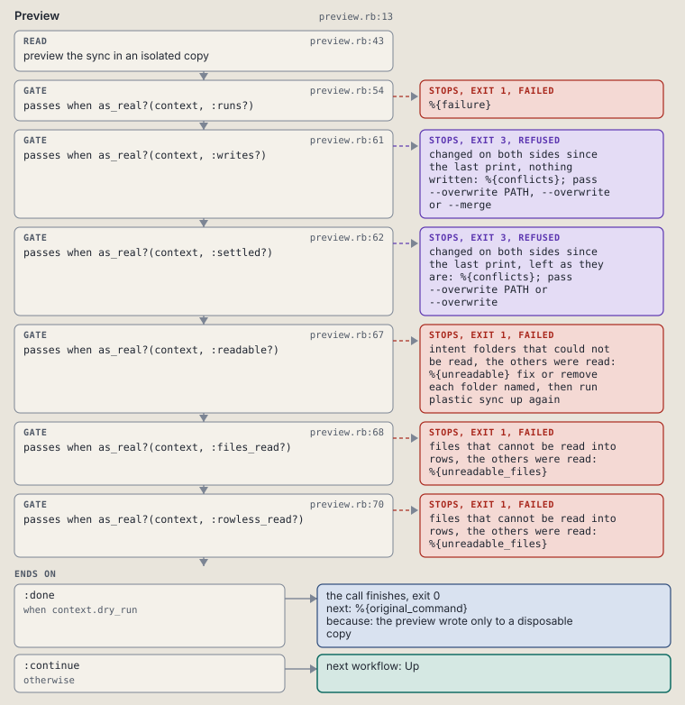
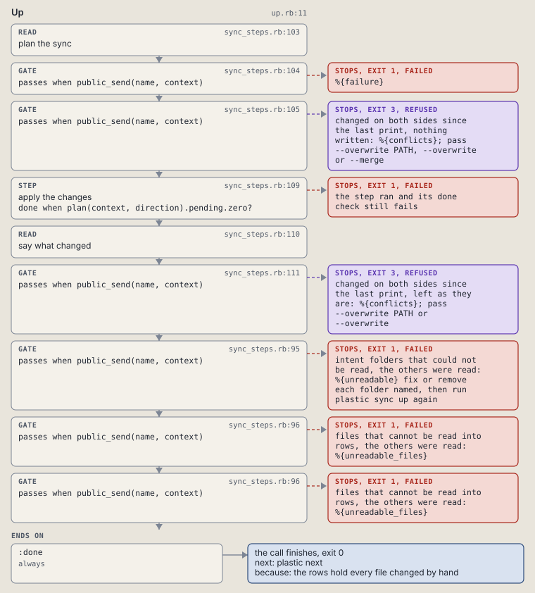
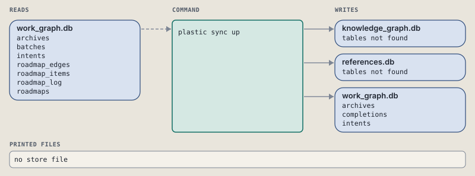

# plastic sync up

Read the files changed by hand into rows.

Reads the files people changed into rows. A record changed on both sides stops the call, exit 3, and every conflict is listed. With one home after the other and a copy of the files between, no change is lost; with a command on each home before the copy, the file that arrives takes the place of the change of the second home. An index that another home printed sets the title, the state, the disposition, the reason and the closed time of every intent it lists. So with a command on each home before the copy, it takes back a change of this home, also on an intent that the other home never changed. A file deleted on one home is printed again from rows on the other.

```sh
plastic sync up [--overwrite [PATH]] [--merge] [--dry-run]
```

The command is `Sync::Up`, in [`up.rb:15`](../../../../lib/plastic/commands/sync/up.rb#L15). The words on this page, such as gate, step and outcome, are explained in [the command DSL](../../dsl/README.md).

| Argument or option | What it gives | Default |
| --- | --- | --- |
| `--overwrite [PATH]` | read the file of the path into rows, or every file with no path | `false` |
| `--merge` | apply the one-sided changes, then list the conflicts | `false` |
| `--dry-run` | preview the complete sync in a disposable copy | `false` |

## Components



The figure shows the command, the workflows it runs, the classes behind them, and the databases and files they reach.

## The events of one call



| Workflow | Kind | Code |
| --- | --- | --- |
| [Code::Sync::Up::Preview](#codesyncuppreview) | code | [`preview.rb:13`](../../../../lib/plastic/workflows/code/sync/up/preview.rb#L13) |
| [Code::Sync::Up](#codesyncup) | code | [`up.rb:11`](../../../../lib/plastic/workflows/code/sync/up.rb#L11) |

### Code::Sync::Up::Preview

The code workflow `:code_preview_sync`, in [`preview.rb:13`](../../../../lib/plastic/workflows/code/sync/up/preview.rb#L13).

Previews the same sync in a copy before the normal write workflow, and refuses what the real run refuses.



Its rows run in this order:

1. Read: preview the sync in an isolated copy. [`preview.rb:43`](../../../../lib/plastic/workflows/code/sync/up/preview.rb#L43)
2. Gate: passes when `as_real?(context, :runs?)`; otherwise the call stops with exit 1 and prints FAILURE. [`preview.rb:54`](../../../../lib/plastic/workflows/code/sync/up/preview.rb#L54)
3. Gate: passes when `as_real?(context, :writes?)`; otherwise the call stops with exit 3 and prints changed on both sides since the last print, nothing written. --overwrite PATH reads that file into rows, --overwrite reads every file, --merge applies the one-sided changes and lists the rest. The records: CONFLICTS. [`preview.rb:61`](../../../../lib/plastic/workflows/code/sync/up/preview.rb#L61)
4. Gate: passes when `as_real?(context, :settled?)`; otherwise the call stops with exit 3 and prints changed on both sides since the last print, left as they are. --overwrite PATH reads that file into rows, --overwrite reads every file. The records: CONFLICTS. [`preview.rb:62`](../../../../lib/plastic/workflows/code/sync/up/preview.rb#L62)
5. Gate: passes when `as_real?(context, :readable?)`; otherwise the call stops with exit 1 and prints intent folders that could not be read, the others were read: UNREADABLE fix or remove each folder named, then run plastic sync up again. [`preview.rb:67`](../../../../lib/plastic/workflows/code/sync/up/preview.rb#L67)
6. Gate: passes when `as_real?(context, :files_read?)`; otherwise the call stops with exit 1 and prints files that cannot be read into rows, the others were read: UNREADABLE_FILES. [`preview.rb:68`](../../../../lib/plastic/workflows/code/sync/up/preview.rb#L68)
7. Gate: passes when `as_real?(context, :rowless_read?)`; otherwise the call stops with exit 1 and prints files that cannot be read into rows, the others were read: UNREADABLE_FILES. [`preview.rb:70`](../../../../lib/plastic/workflows/code/sync/up/preview.rb#L70)
8. Outcome `:done`, when `context.dry_run`: finishes with exit 0; next: ORIGINAL_COMMAND. [`preview.rb:49`](../../../../lib/plastic/workflows/code/sync/up/preview.rb#L49)
9. Outcome `:continue`, otherwise: starts the workflow [Code::Sync::Up](#codesyncup). [`preview.rb:50`](../../../../lib/plastic/workflows/code/sync/up/preview.rb#L50)

It sets `failure`, `conflicts`, `merging`, `unreadable`, `unreadable_files`, `unreadable_path`, `unreadable_rowless`.

### Code::Sync::Up

The code workflow `:code_sync_up`, in [`up.rb:11`](../../../../lib/plastic/workflows/code/sync/up.rb#L11).

Sync up: plans, applies, and refuses on the conflicts left.



Its rows run in this order:

1. Read: plan the sync. [`sync_steps.rb:111`](../../../../lib/plastic/workflows/sync_steps.rb#L111)
2. Gate: passes when `public_send(name, context)`; otherwise the call stops with exit 1 and prints FAILURE. [`sync_steps.rb:112`](../../../../lib/plastic/workflows/sync_steps.rb#L112)
3. Gate: passes when `public_send(name, context)`; otherwise the call stops with exit 3 and prints changed on both sides since the last print, nothing written. --overwrite PATH reads that file into rows, --overwrite reads every file, --merge applies the one-sided changes and lists the rest. The records: CONFLICTS. [`sync_steps.rb:103`](../../../../lib/plastic/workflows/sync_steps.rb#L103)
4. Step: apply the changes. Done when `plan(context, direction).pending.zero?`, so a second call skips it. [`sync_steps.rb:117`](../../../../lib/plastic/workflows/sync_steps.rb#L117)
5. Read: say what changed. [`sync_steps.rb:118`](../../../../lib/plastic/workflows/sync_steps.rb#L118)
6. Gate: passes when `public_send(name, context)`; otherwise the call stops with exit 3 and prints changed on both sides since the last print, left as they are. --overwrite PATH reads that file into rows, --overwrite reads every file. The records: CONFLICTS. [`sync_steps.rb:103`](../../../../lib/plastic/workflows/sync_steps.rb#L103)
7. Gate: passes when `public_send(name, context)`; otherwise the call stops with exit 1 and prints intent folders that could not be read, the others were read: UNREADABLE fix or remove each folder named, then run plastic sync up again. [`sync_steps.rb:103`](../../../../lib/plastic/workflows/sync_steps.rb#L103)
8. Gate: passes when `public_send(name, context)`; otherwise the call stops with exit 1 and prints files that cannot be read into rows, the others were read: UNREADABLE_FILES. [`sync_steps.rb:104`](../../../../lib/plastic/workflows/sync_steps.rb#L104)
9. Gate: passes when `public_send(name, context)`; otherwise the call stops with exit 1 and prints files that cannot be read into rows, the others were read: UNREADABLE_FILES. [`sync_steps.rb:104`](../../../../lib/plastic/workflows/sync_steps.rb#L104)
10. Outcome `:done`, always: finishes with exit 0; next: plastic next. [`sync_steps.rb:99`](../../../../lib/plastic/workflows/sync_steps.rb#L99)

It sets `failure`, `conflicts`, `merging`, `unreadable`, `unreadable_files`, `unreadable_path`, `unreadable_rowless`, `lines`.

In the words of workflow engines, the rows are these four parts:

- **Trigger**: the call starts the workflow `Code::Sync::Up::Preview`; each later workflow starts from an outcome of the one before it.
- **Activities**: 3 reads and 1 step.
- **Transitions**: 12 gates stop the call when their checks fail; a step runs only while its done check fails; Preview goes to Up on `:continue`.
- **Outcomes**: `:done` of Preview, `:done` of Up end the call.

## What one call reads, writes and prints



| Place | Database or file | Tables | Reads or writes | Code |
| --- | --- | --- | --- | --- |
| the store folder | knowledge_graph.db | not found in the code | writes | found in the code, not declared |
| the store folder | references.db | not found in the code | writes | found in the code, not declared |
| the store folder | work_graph.db | `archives`, `batches`, `completions`, `intents`, `roadmap_edges`, `roadmap_items`, `roadmap_log`, `roadmaps` | reads and writes | found in the code, not declared |

A second call runs the same rows again. A step runs again only when its done check fails.

| Step | Done when | The second call | Code |
| --- | --- | --- | --- |
| apply the changes | `plan(context, direction).pending.zero?` | skips it | [`sync_steps.rb:117`](../../../../lib/plastic/workflows/sync_steps.rb#L117) |

## How a call ends

Every call can also end in [the ways any call can end](../../dsl/README.md#how-any-call-can-end).

| Ending | Exit | next: | Code |
| --- | --- | --- | --- |
| FAILURE | 1 | prints no next: line | [`preview.rb:54`](../../../../lib/plastic/workflows/code/sync/up/preview.rb#L54) |
| changed on both sides since the last print, nothing written. --overwrite PATH reads that file into rows, --overwrite reads every file, --merge applies the one-sided changes and lists the rest. The records: CONFLICTS | 3 | prints no next: line | [`preview.rb:61`](../../../../lib/plastic/workflows/code/sync/up/preview.rb#L61) |
| changed on both sides since the last print, left as they are. --overwrite PATH reads that file into rows, --overwrite reads every file. The records: CONFLICTS | 3 | prints no next: line | [`preview.rb:62`](../../../../lib/plastic/workflows/code/sync/up/preview.rb#L62) |
| intent folders that could not be read, the others were read: UNREADABLE fix or remove each folder named, then run plastic sync up again | 1 | prints no next: line | [`preview.rb:67`](../../../../lib/plastic/workflows/code/sync/up/preview.rb#L67) |
| files that cannot be read into rows, the others were read: UNREADABLE_FILES | 1 | plastic sync down --overwrite UNREADABLE_PATH | [`preview.rb:68`](../../../../lib/plastic/workflows/code/sync/up/preview.rb#L68) |
| files that cannot be read into rows, the others were read: UNREADABLE_FILES | 1 | prints no next: line | [`preview.rb:70`](../../../../lib/plastic/workflows/code/sync/up/preview.rb#L70) |
| the preview wrote only to a disposable copy | 0 | ORIGINAL_COMMAND | [`preview.rb:49`](../../../../lib/plastic/workflows/code/sync/up/preview.rb#L49) |
| FAILURE | 1 | prints no next: line | [`sync_steps.rb:112`](../../../../lib/plastic/workflows/sync_steps.rb#L112) |
| changed on both sides since the last print, nothing written. --overwrite PATH reads that file into rows, --overwrite reads every file, --merge applies the one-sided changes and lists the rest. The records: CONFLICTS | 3 | prints no next: line | [`sync_steps.rb:103`](../../../../lib/plastic/workflows/sync_steps.rb#L103) |
| changed on both sides since the last print, left as they are. --overwrite PATH reads that file into rows, --overwrite reads every file. The records: CONFLICTS | 3 | prints no next: line | [`sync_steps.rb:103`](../../../../lib/plastic/workflows/sync_steps.rb#L103) |
| intent folders that could not be read, the others were read: UNREADABLE fix or remove each folder named, then run plastic sync up again | 1 | prints no next: line | [`sync_steps.rb:103`](../../../../lib/plastic/workflows/sync_steps.rb#L103) |
| files that cannot be read into rows, the others were read: UNREADABLE_FILES | 1 | plastic sync down --overwrite UNREADABLE_PATH | [`sync_steps.rb:104`](../../../../lib/plastic/workflows/sync_steps.rb#L104) |
| files that cannot be read into rows, the others were read: UNREADABLE_FILES | 1 | prints no next: line | [`sync_steps.rb:104`](../../../../lib/plastic/workflows/sync_steps.rb#L104) |
| the rows hold every file changed by hand | 0 | plastic next | [`sync_steps.rb:99`](../../../../lib/plastic/workflows/sync_steps.rb#L99) |
| a step raises | 1 | prints no next: line | [`code_workflow.rb:107`](../../../../lib/plastic/code_workflow.rb#L107) |

## What the page leaves out

Every call shares a few things that this page does not repeat; [the command DSL](../../dsl/README.md#what-every-call-shares) names them.

- A call that writes saves a routine run row in local.db. A stop by a gate or a step saves the run, and the next call resumes from it. A dry run saves no row.
