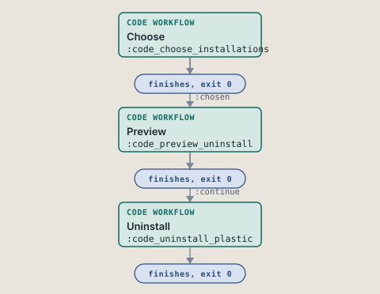
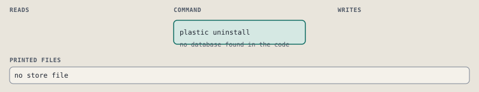

# plastic uninstall

Remove Plastic from agents and keep the home.

Shows the harnesses Plastic is installed into or found in, with every recorded one picked, and removes what the record of each picked one lists. The home and its stores stay. See docs/help/choice-screen.md.

```sh
plastic uninstall [ANSWER] [--dry-run]
```

The command is `Uninstall`, in [`uninstall.rb:12`](../../../../lib/plastic/commands/uninstall.rb#L12). The words on this page, such as gate, step and outcome, are explained in [the command DSL](../../dsl/README.md).

| Argument or option | What it gives | Default |
| --- | --- | --- |
| `ANSWER` | the person's answer to the numbered list | |
| `--dry-run` | list what would change and change nothing | `false` |

## Components


The figure shows the command, the workflows it runs, the classes behind them, and the databases and files they reach.

## The events of one call



| Workflow | Kind | Code |
| --- | --- | --- |
| [Code::Uninstall::Choose](#codeuninstallchoose) | code | [`choose.rb:14`](../../../../lib/plastic/workflows/code/uninstall/choose.rb#L14) |
| [Code::Uninstall::Preview](#codeuninstallpreview) | code | [`preview.rb:16`](../../../../lib/plastic/workflows/code/uninstall/preview.rb#L16) |
| [Code::Uninstall](#codeuninstall) | code | [`uninstall.rb:14`](../../../../lib/plastic/workflows/code/uninstall.rb#L14) |

### The command's own call

The command's own `call`, at [`harness_pick.rb:12`](../../../../lib/plastic/commands/harness_pick.rb#L12), runs first, then starts the workflow [Code::Uninstall::Choose](#codeuninstallchoose).

```ruby
def call
  answer = parsed[:answer] ||= answered_on_screen
  super if answer
end
```

### Code::Uninstall::Choose

The code workflow `:code_choose_installations`, in [`choose.rb:14`](../../../../lib/plastic/workflows/code/uninstall/choose.rb#L14).

Reads the person's answer against the harnesses Plastic is installed into or found in.


Its rows run in this order:

1. Read: list the recorded and the found harnesses and read the person's answer. [`choose.rb:19`](../../../../lib/plastic/workflows/code/uninstall/choose.rb#L19)
2. Outcome `:none`, when `context.found.empty?`: finishes with exit 0; next: plastic init. [`choose.rb:28`](../../../../lib/plastic/workflows/code/uninstall/choose.rb#L28)
3. Outcome `:left`, when `context.picked.empty?`: finishes with exit 0; next: plastic uninstall. [`choose.rb:30`](../../../../lib/plastic/workflows/code/uninstall/choose.rb#L30)
4. Outcome `:chosen`, otherwise: starts the workflow [Code::Uninstall::Preview](#codeuninstallpreview). [`choose.rb:32`](../../../../lib/plastic/workflows/code/uninstall/choose.rb#L32)

It sets `found`, `picked`, `harnesses`.

### Code::Uninstall::Preview

The code workflow `:code_preview_uninstall`, in [`preview.rb:16`](../../../../lib/plastic/workflows/code/uninstall/preview.rb#L16).

On a dry run, lists what the record of each picked harness names, the releases and the launcher among them when no harness stays installed, and the home it keeps.


Its rows run in this order:

1. Read: list what the uninstall would remove or change. [`preview.rb:19`](../../../../lib/plastic/workflows/code/uninstall/preview.rb#L19)
2. Outcome `:done`, when `context.dry_run`: finishes with exit 0; next: ORIGINAL_COMMAND. [`preview.rb:29`](../../../../lib/plastic/workflows/code/uninstall/preview.rb#L29)
3. Outcome `:continue`, otherwise: starts the workflow [Code::Uninstall](#codeuninstall). [`preview.rb:31`](../../../../lib/plastic/workflows/code/uninstall/preview.rb#L31)

### Code::Uninstall

The code workflow `:code_uninstall_plastic`, in [`uninstall.rb:14`](../../../../lib/plastic/workflows/code/uninstall.rb#L14).

Removes what the record of each picked harness lists, then the releases and the launcher once no harness stays installed. The home with its stores stays.


Its rows run in this order:

1. Step: remove what each record lists. Done when `context.removed`, so a second call skips it. [`uninstall.rb:21`](../../../../lib/plastic/workflows/code/uninstall.rb#L21)
2. Step: remove the releases and the launcher. Done when `context.releases_removed`, so a second call skips it. [`uninstall.rb:30`](../../../../lib/plastic/workflows/code/uninstall.rb#L30)
3. Outcome `:done`, always: finishes with exit 0; next: plastic init. [`uninstall.rb:37`](../../../../lib/plastic/workflows/code/uninstall.rb#L37)

It sets `removed`, `releases_removed`.

In the words of workflow engines, the rows are these four parts:

- **Trigger**: the call starts the workflow `Code::Uninstall::Choose`; each later workflow starts from an outcome of the one before it.
- **Activities**: 2 reads and 2 steps.
- **Transitions**: a step runs only while its done check fails; Choose goes to Preview on `:chosen`; Preview goes to Uninstall on `:continue`.
- **Outcomes**: `:none` of Choose, `:left` of Choose, `:done` of Preview, `:done` of Uninstall end the call.

## What one call reads, writes and prints



It reads and writes no store database and prints no store file.

A second call runs the same rows again. A step runs again only when its done check fails.

| Step | Done when | The second call | Code |
| --- | --- | --- | --- |
| remove what each record lists | `context.removed` | skips it | [`uninstall.rb:21`](../../../../lib/plastic/workflows/code/uninstall.rb#L21) |
| remove the releases and the launcher | `context.releases_removed` | skips it | [`uninstall.rb:30`](../../../../lib/plastic/workflows/code/uninstall.rb#L30) |

## How a call ends

Every call can also end in [the ways any call can end](../../dsl/README.md#how-any-call-can-end).

| Ending | Exit | next: | Code |
| --- | --- | --- | --- |
| Plastic is installed into no harness and no registered harness was found | 0 | plastic init | [`choose.rb:28`](../../../../lib/plastic/workflows/code/uninstall/choose.rb#L28) |
| the person left with no change | 0 | plastic uninstall | [`choose.rb:30`](../../../../lib/plastic/workflows/code/uninstall/choose.rb#L30) |
| the preview changed no file | 0 | ORIGINAL_COMMAND | [`preview.rb:29`](../../../../lib/plastic/workflows/code/uninstall/preview.rb#L29) |
| Plastic is removed from HARNESSES; the home stays | 0 | plastic init | [`uninstall.rb:37`](../../../../lib/plastic/workflows/code/uninstall.rb#L37) |
| a step raises | 1 | prints no next: line | [`code_workflow.rb:102`](../../../../lib/plastic/code_workflow.rb#L102) |

## What the page leaves out

Every call shares a few things that this page does not repeat; [the command DSL](../../dsl/README.md#what-every-call-shares) names them.
