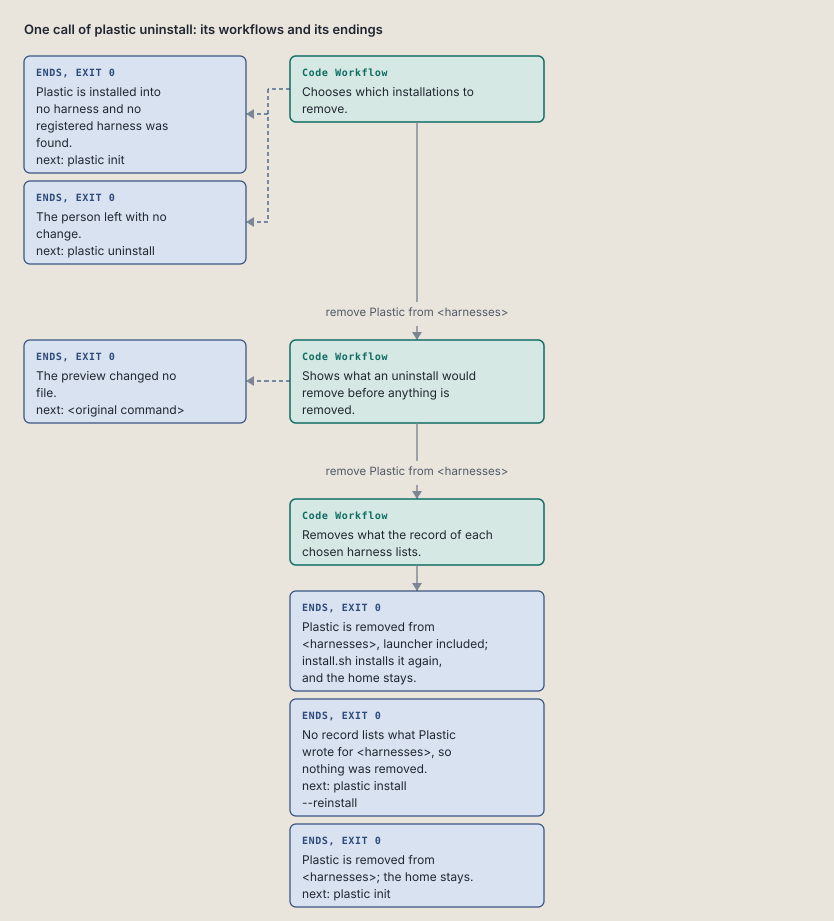
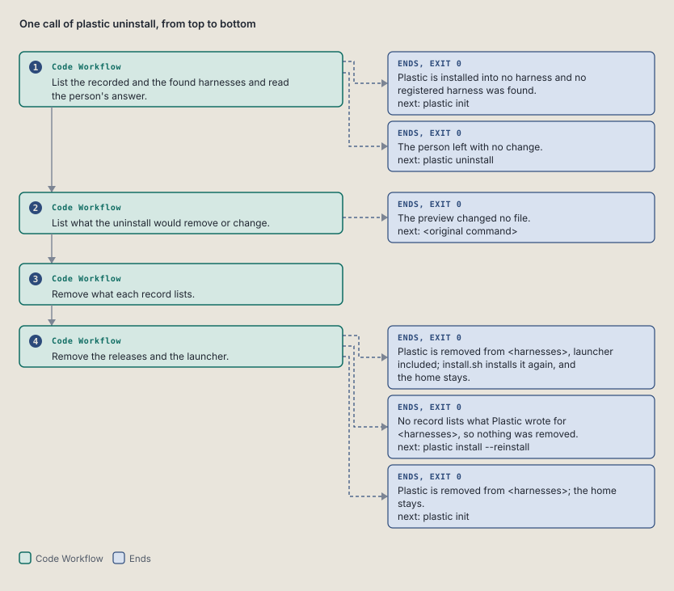

# plastic uninstall

Remove Plastic from agents and keep the home.

```sh
plastic uninstall [ANSWER] [--dry-run]
```

| Argument or option | What it gives | Default |
| --- | --- | --- |
| `ANSWER` | the person's answer to the numbered list | |
| `--dry-run` | list what would change and change nothing | `false` |

## The workflows of one call



Each box is a workflow. The words between the boxes say when the call moves on, and the last boxes say how the call ends.

## The events of one call, step by step



The boxes on the left run in order. The boxes on the right are the ways the call stops or ends at that step.

## What one call changes

| What changes | Where | Reach |
| --- | --- | --- |
| What each record lists is removed from the picked harnesses | the settings of the agent harness, in the home folder | stays on this machine |
| The records of the removed installations are deleted | the Plastic home folder | stays on this machine |
| The release folders and the launcher are removed from the Plastic home | the Plastic home folder | stays on this machine |

The command is `Plastic::Commands::Uninstall`, in [`commands/uninstall.rb`](../../../../lib/plastic/commands/uninstall.rb).
