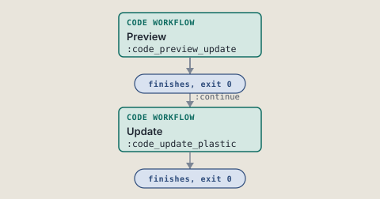
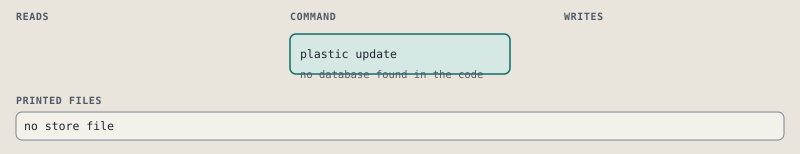

# plastic update

Sync a newer package into the home or name the installer command.

Syncs a newer running package into the home, or activates the newest release of the chosen channel, by default the active release's own.

```sh
plastic update [--channel NAME] [--dry-run]
```

The command is `Update`, in [`update.rb:10`](../../../../lib/plastic/commands/update.rb#L10). The words on this page, such as gate, step and outcome, are explained in [the command DSL](../../dsl/README.md).

| Argument or option | What it gives | Default |
| --- | --- | --- |
| `--channel NAME` | update from this channel: stable, beta or alpha |  |
| `--dry-run` | name both versions and change nothing | `false` |

## Components


The figure shows the command, the workflows it runs, the classes behind them, and the databases and files they reach.

## The events of one call



| Workflow | Kind | Code |
| --- | --- | --- |
| [Code::Update::Preview](#codeupdatepreview) | code | [`preview.rb:14`](../../../../lib/plastic/workflows/code/update/preview.rb#L14) |
| [Code::Update](#codeupdate) | code | [`update.rb:15`](../../../../lib/plastic/workflows/code/update.rb#L15) |

### The command's own call

The command's own `call`, at [`update.rb:16`](../../../../lib/plastic/commands/update.rb#L16), runs first, then starts the workflow [Code::Update::Preview](#codeupdatepreview).

```ruby
def call
  channel = parsed[:channel]
  raise CLI::Command::Usage, "--channel takes stable, beta or alpha" unless [nil, *Workflows::ReleaseUpdate::CHANNELS.keys].include?(channel)

  super
end
```

### Code::Update::Preview

The code workflow `:code_preview_update`, in [`preview.rb:14`](../../../../lib/plastic/workflows/code/update/preview.rb#L14).

Compares the installed version with the running package. A dry run names both and what the update would do.


Its rows run in this order:

1. Read: compare the installed and the running versions. [`preview.rb:19`](../../../../lib/plastic/workflows/code/update/preview.rb#L19)
2. Gate: passes when `!context.from.nil?`; otherwise the call stops with exit 3 and prints Plastic is not installed under this home; run plastic install first. [`preview.rb:25`](../../../../lib/plastic/workflows/code/update/preview.rb#L25)
3. Read: say what the update would do. [`preview.rb:28`](../../../../lib/plastic/workflows/code/update/preview.rb#L28)
4. Outcome `:done`, when `context.dry_run`: finishes with exit 0; next: ORIGINAL_COMMAND. [`preview.rb:35`](../../../../lib/plastic/workflows/code/update/preview.rb#L35)
5. Outcome `:continue`, otherwise: starts the workflow [Code::Update](#codeupdate). [`preview.rb:36`](../../../../lib/plastic/workflows/code/update/preview.rb#L36)

It sets `from`, `to`.

### Code::Update

The code workflow `:code_update_plastic`, in [`update.rb:15`](../../../../lib/plastic/workflows/code/update.rb#L15).

Syncs a newer running package into the home for the registered agents. When the running package is not newer, activates the newest release of the chosen channel, or of the active release's channel, and syncs its files into the home. With no release activated yet, names the installer command that installs one.


Its rows run in this order:

1. Read: check whether the running package is newer. [`update.rb:20`](../../../../lib/plastic/workflows/code/update.rb#L20)
2. Step: sync the newer package into the home. Done when `!context.newer || context.synced`, so a second call skips it. [`update.rb:24`](../../../../lib/plastic/workflows/code/update.rb#L24)
3. Read: find a newer release on the chosen channel. [`update.rb:32`](../../../../lib/plastic/workflows/code/update.rb#L32)
4. Step: activate the newer release. Done when `context.release.nil? || context.activated`, so a second call skips it. [`update.rb:36`](../../../../lib/plastic/workflows/code/update.rb#L36)
5. Outcome `:done`, when `context.synced`: finishes with exit 0; next: plastic version. [`update.rb:40`](../../../../lib/plastic/workflows/code/update.rb#L40)
6. Outcome `:activated`, when `context.activated`: finishes with exit 0; next: plastic version. [`update.rb:41`](../../../../lib/plastic/workflows/code/update.rb#L41)
7. Outcome `:current`, when `context.active`: finishes with exit 0; next: plastic version. [`update.rb:43`](../../../../lib/plastic/workflows/code/update.rb#L43)
8. Outcome `:fetch`, otherwise: finishes with exit 0; next: plastic update. [`update.rb:45`](../../../../lib/plastic/workflows/code/update.rb#L45)

It sets `newer`, `synced`, `active`, `release`, `activated`.

In the words of workflow engines, the rows are these four parts:

- **Trigger**: the call starts the workflow `Code::Update::Preview`; each later workflow starts from an outcome of the one before it.
- **Activities**: 4 reads and 2 steps.
- **Transitions**: 1 gate stops the call when its check fails; a step runs only while its done check fails; Preview goes to Update on `:continue`.
- **Outcomes**: `:done` of Preview, `:done` of Update, `:activated` of Update, `:current` of Update, `:fetch` of Update end the call.

## What one call reads, writes and prints



It reads and writes no store database and prints no store file.

A second call runs the same rows again. A step runs again only when its done check fails.

| Step | Done when | The second call | Code |
| --- | --- | --- | --- |
| sync the newer package into the home | `!context.newer \|\| context.synced` | skips it | [`update.rb:24`](../../../../lib/plastic/workflows/code/update.rb#L24) |
| activate the newer release | `context.release.nil? \|\| context.activated` | skips it | [`update.rb:36`](../../../../lib/plastic/workflows/code/update.rb#L36) |

## How a call ends

Every call can also end in [the ways any call can end](../../dsl/README.md#how-any-call-can-end).

| Ending | Exit | next: | Code |
| --- | --- | --- | --- |
| Plastic is not installed under this home; run plastic install first | 3 | prints no next: line | [`preview.rb:25`](../../../../lib/plastic/workflows/code/update/preview.rb#L25) |
| the preview changed no file | 0 | ORIGINAL_COMMAND | [`preview.rb:35`](../../../../lib/plastic/workflows/code/update/preview.rb#L35) |
| the home holds Plastic TO | 0 | plastic version | [`update.rb:40`](../../../../lib/plastic/workflows/code/update.rb#L40) |
| Plastic ACTIVATED is active and the home holds its files | 0 | plastic version | [`update.rb:41`](../../../../lib/plastic/workflows/code/update.rb#L41) |
| Plastic ACTIVE is the newest release on its channel | 0 | plastic version | [`update.rb:43`](../../../../lib/plastic/workflows/code/update.rb#L43) |
| run the installer command above, then update again | 0 | plastic update | [`update.rb:45`](../../../../lib/plastic/workflows/code/update.rb#L45) |
| a step raises | 1 | prints no next: line | [`code_workflow.rb:102`](../../../../lib/plastic/code_workflow.rb#L102) |
| Usage error: --channel takes stable, beta or alpha | 2 | prints no next: line | [`update.rb:18`](../../../../lib/plastic/commands/update.rb#L18) |

## What the page leaves out

Every call shares a few things that this page does not repeat; [the command DSL](../../dsl/README.md#what-every-call-shares) names them.
