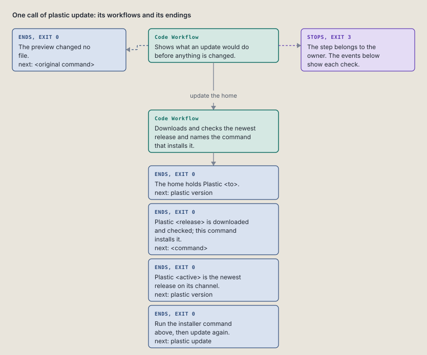
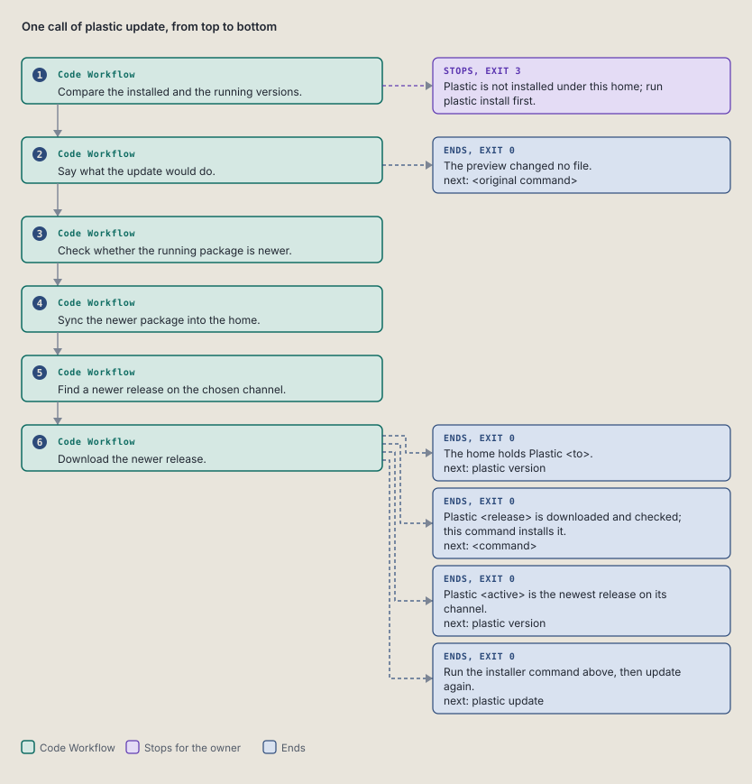

# plastic update

Sync a newer package into the home or name the installer command.

```sh
plastic update [--channel NAME] [--dry-run]
```

| Argument or option | What it gives | Default |
| --- | --- | --- |
| `--channel NAME` | update from this channel: stable, beta or alpha |  |
| `--dry-run` | name both versions and change nothing | `false` |

## The workflows of one call



Each box is a workflow. The words between the boxes say when the call moves on, and the last boxes say how the call ends.

## The events of one call, step by step



The boxes on the left run in order. The boxes on the right are the ways the call stops or ends at that step.

## What one call changes

| What changes | Where | Reach |
| --- | --- | --- |
| The newer package is synced into the Plastic home | the Plastic home folder | stays on this machine |
| The installed agents are refreshed | the settings of the agent harness, in the home folder | stays on this machine |
| The newer release is downloaded and made the active release | the Plastic home folder | stays on this machine |

The command is `Plastic::Commands::Update`, in [`commands/update.rb`](../../../../lib/plastic/commands/update.rb).
