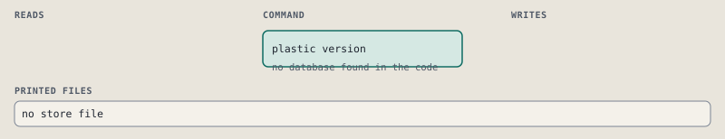

# plastic version

Print the installed Plastic version and release channel.

The version of the package this command came from, its channel and the file it was read from.

```sh
plastic version
```

The command is `Version`, in [`version.rb:9`](../../../../lib/plastic/commands/version.rb#L9). The words on this page, such as gate, step and outcome, are explained in [the command DSL](../../dsl/README.md).

## Components


The figure shows the command, the workflows it runs, the classes behind them, and the databases and files they reach.

## The events of one call

The call starts the workflow `Code::Version`, in [`version.rb:11`](../../../../lib/plastic/workflows/code/version.rb#L11).

Reads the version of the running package: its VERSION file when it has one, as an installed copy does, otherwise its package.json.


Its rows run in this order:

1. Read: find the version file of the running package. [`version.rb:16`](../../../../lib/plastic/workflows/code/version.rb#L16)
2. Gate: passes when `!context.source.nil?`; otherwise the call stops with exit 1 and prints the running package has no VERSION file and no package.json. [`version.rb:20`](../../../../lib/plastic/workflows/code/version.rb#L20)
3. Read: say the version and its channel. [`version.rb:23`](../../../../lib/plastic/workflows/code/version.rb#L23)
4. Outcome `:done`, always: finishes with exit 0; next: plastic status. [`version.rb:30`](../../../../lib/plastic/workflows/code/version.rb#L30)

It sets `source`.

In the words of workflow engines, the rows are these four parts:

- **Trigger**: the call starts the workflow `Code::Version`.
- **Activities**: 2 reads.
- **Transitions**: 1 gate stops the call when its check fails.
- **Outcomes**: `:done` end the call.

## What one call reads, writes and prints



It reads and writes no store database and prints no store file.

## How a call ends

Every call can also end in [the ways any call can end](../../dsl/README.md#how-any-call-can-end).

| Ending | Exit | next: | Code |
| --- | --- | --- | --- |
| the running package has no VERSION file and no package.json | 1 | prints no next: line | [`version.rb:20`](../../../../lib/plastic/workflows/code/version.rb#L20) |
| the command line works, so read the work next | 0 | plastic status | [`version.rb:30`](../../../../lib/plastic/workflows/code/version.rb#L30) |
| a step raises | 1 | prints no next: line | [`code_workflow.rb:102`](../../../../lib/plastic/code_workflow.rb#L102) |

## What the page leaves out

Every call shares a few things that this page does not repeat; [the command DSL](../../dsl/README.md#what-every-call-shares) names them.

- No gate of this command refuses, so exit 3 never happens.
